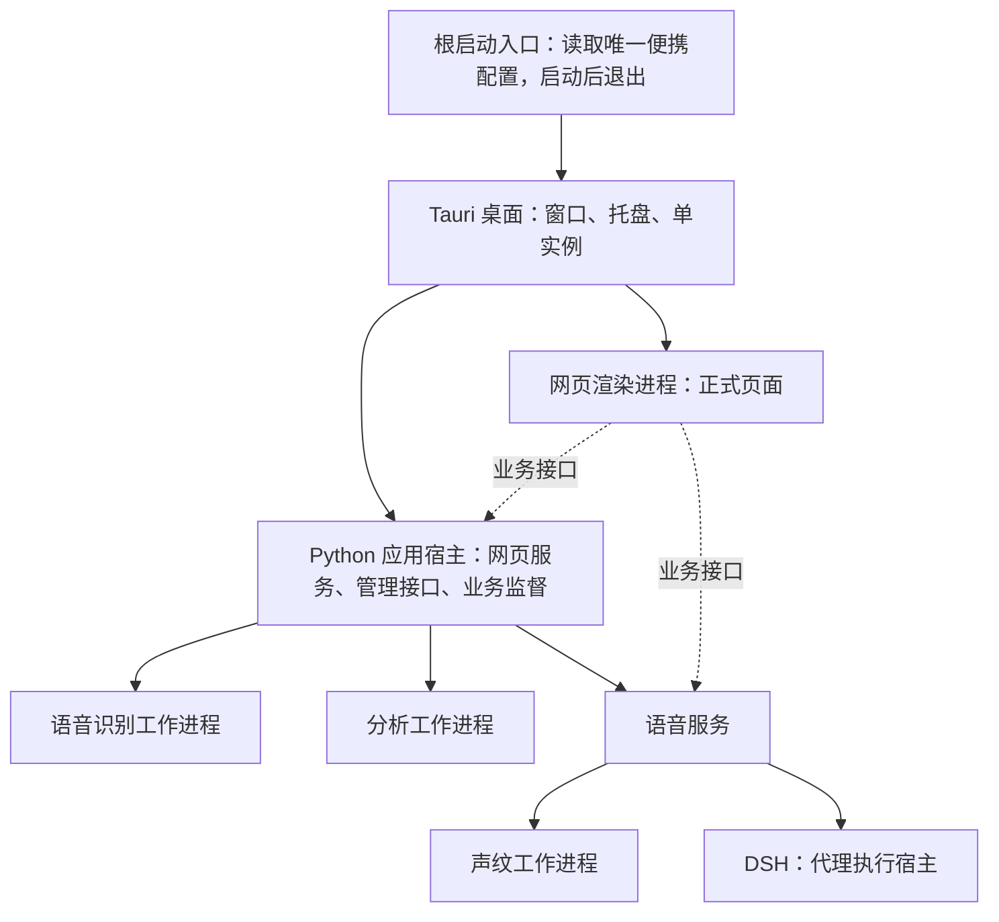

# Voice Terminal 架构与生命周期

本文是当前组件边界和生命周期的唯一说明。模型可见字段见[上下文与工具规范](context-and-tools.md)；WebSocket 消息见[协议文档](websocket-protocol.md)；质量门槛见[运行与质量门槛](operations-and-quality.md)。

Tauri 2（桌面框架）拥有窗口、托盘、单实例与 Python（后端运行环境）服务管理进程。应用宿主直接管理语音识别、分析和语音服务，委托语音服务管理 DSH（代理执行宿主）与声纹工作进程；每个进程只有一个直接生命周期所有者。关闭桌面窗口隐藏到托盘，明确退出应用回收整棵受管进程树。主产品与源码界面调试只支持桌面入口，独立样例由原生宿主管理其开发服务。启动反馈和进程状态契约见[独立应用启动与系统管理](application-lifecycle.md)，便携路径与数据边界见[桌面应用说明](desktop-application.md)。

语音当前会话始终持久化到用户历史目录的 `archives/.journals/active-session.sqlite3`（当前会话数据库）；正式和源码布局共用
`.local/data/history/`（唯一历史数据目录）。启动先恢复会话身份、日期基准、
模型语义历史、已播出回复、转写精修、聊天顺序和后台上下文代次，再创建业务组件。仅保存旧身份文件不足以恢复聊天。
聊天列表继续保留最近 200 条，完整模型历史及交付归档按原顺序保存在数据库，有界读取缓存不会截断正文。
当前会话持久化不依赖 `disk_history`（其他历史落盘候选开关）。检查点与待写正文在同一数据库事务提交，损坏或缺失时报告恢复失败，
不以空历史覆盖已有记录。重启只恢复已提交材料，不重新播放语音或执行旧模型动作；手动重置和一小时共同静默交接才开始新会话。

## 总体结构

应用进程的所有权关系：



应用宿主先提供管理入口，通过私有标准输入／输出管道报告就绪，桌面确认接管后才启动业务组件；受管模式停用旧浏览器、托盘和应用单实例职责。启动过程不在宿主中导入音频或模型推理模块。网页服务与宿主共享进程，网页状态和退出入口因此不依赖语音服务就绪。桌面的 Windows Job Object（作业对象）覆盖受管进程树，组件组可独立回收；外部调试进程只标记为外部，不加入回收范围。该进程所有权层不增加语音事务或代理调度循环。

进入上述业务启动前，桌面先按当前随包清单核验完整语音运行环境、全部模型及代理组件。任一必需组件缺失、文件集合或大小不符、待更新时，只挂载原生组件管理页，整体语音与业务服务保持停止；功能开关不免除安装组件的就绪要求。新安装按当前清单准备，旧组件使用卡片中的“更新、导入、跳转”，不提供旧模型推理适配。Voice Server 启动及恢复时核对文件集合和大小，模型及代理组件仍逐文件核验完整摘要；运行环境安装、导入和更新继续核验完整摘要。

组件候选在独立暂存目录下载和校验，切换阶段暂停此前运行的服务并保留恢复备份。全部当前组件就绪后才恢复服务，提交成功后删除旧目录；失败保留或恢复旧内容供重试，但旧组件不因此获得启动资格。共享运行环境的组装使用独立互斥，避免两个模型任务同时改写解释器。详情见[必需组件更新](model-resource-updates.md)及[内存优化验收](memory-optimization-20261010.md)。

资源管理页采用即时事件与定时补查：组件提交和任务终态要求重读最新清单，活动任务每两秒、空闲每十秒及焦点恢复时补查。`resource_jobs`（轻量任务快照接口）只读取宿主内存，`created_at`（任务创建时间）和 `revision`（状态修订号）统一事件与快照顺序；在途清单遇到新刷新要求会重新读取，慢磁盘期间不叠加定时请求。手动启动先进入统一加载页，再在后台快速盘点语音环境、累计复核其他组件，并重新解析首次安装后的代理路径。

下载通道全局最多四条，每次复制及全量摘要核验最多四个线程。复制阶段同时计算源摘要并读回目标复核，模型收据使用已核验记录；同一宿主中的后续模型任务，仅在已验证共享环境的清单摘要、受管文件路径、大小和修改时间指纹未变化时复用环境。启动时所有组件共用一条累计进度条；Voice Server（语音服务）使用快速文件集合与大小盘点，模型和 DSH（代理执行宿主）按摘要已核验字节推进。实现规则和验证边界见[下载与首次启动修复](download-startup-flow-20261010.md)。

```text
输入设备
  ├─ KWS standby ──唤醒──> ASR / VAD
  └─ ASR / VAD ──> EpisodeController ──> 主 LLM
                                      └─> Speech transaction ──> TTS / Player

SessionLedger ──> LLMContextProjector ──> 主 LLM 请求
             └─> ShadowContextProjector ──> 单一 ShadowRuntime ──> 当前后端已授予的工具
                                                                     ├─ Product UI
                                                                     └─ 主 LLM 400ms mailbox
```

主要入口：

- `ApplicationHost`（应用宿主）：管理整套系统的启动、恢复、健康检查、指标采样和退出，保留失败时的独立诊断入口。
- `SessionRuntime`：创建和关闭服务资源，管理 session、设置、KWS、Shadow 和 provider。
- `EpisodeController`：拥有一次语音 episode 的输入、调度、TTS 和 reset 语义。
- `AgentEpisodeRuntime`：拥有唯一活动 LLM 请求和调度循环；确定性时钟、提示文本和流式语音准入由内部协作模块实现。
- `EpisodeSpeechOutput`：维护 speak transaction、发送前沿、TTS 分段、播放和 delivery 结算。
- `SessionLedger`：记录用户输入、已传达 assistant 文本、有效 refinement、工具结果和有语义影响的打断。
- `ShadowRuntime`（后台运行实例）：每个 session（会话）一个，与语音交互共同构成同一助手；异步执行当前后端已授予的工具和状态观察。原生业务工具保持只读，DSH（后台执行宿主）使用实际执行环境权限；后台不拥有语音控制权，DSH 根执行环节仅有提前静默请求这一受限例外。

## 不可破坏的不变量

### 主语音链

- 一个 episode 只有一个 Agent 调度循环和一个活动 provider 请求。
- `request_shadow` 只能是 `{"request": true}`；主模型不能向 Shadow 传任务文本或意图摘要。
- 用户自定义指令以同一会话快照分别投影给主模型与 Shadow；保存后的修改在新会话或 reset 后同时生效。
- `wait` 表示不改变语音队列；`speak` 只表达仍相关且尚未传达的新内容；`revision` 只改尚未发送的尾巴且只写新尾巴；`cancel` 空文本用于必须立即停止、`cancel` 带文本用于停止并替换。
- 未播放的 assistant 草稿不进入 HISTORY；实际传达内容在结算时通过冻结的 `voice_delivery` 追加。
- ASR refinement 更新当前输入和诊断，不回写已经提交的用户 HISTORY。
- 新输入创建不撤销有效输出事务的播放许可，播放前暂停必须保留队列；恢复失败按取消结算，不得报告可播放。声纹拦截模式下未准入声音继续识别，但不能暂停有效待播回复。实现与验证见[语音可靠性修复](voice-reliability-fixes-20261010.md)。

#### 语音端点与分析模型

- Voice Server 的 FSMN‑VAD（语音活动检测模型）以 `vad.end_silence_ms`（VAD 结束静音时长）200ms 判断停顿。每次 `speech_ended`（语音结束事件）只启动一次 SmartTurn（语句结束判断）；`candidate_ms`（候选等待时长）和 `recheck_ms`（重试间隔）只为旧配置兼容读取，不再影响端点判断。
- VAD 在 SmartTurn 推理时持续接收音频。若检测到再次开口，控制器立即使该次判断失效，并通过分析 WebSocket 的 `cancel`（取消消息）通知工作进程；SmartTurn 每次推理使用独立的 ONNX Runtime `RunOptions`（推理选项）请求终止。分析通道只有在原生推理实际结束后才释放，因此取消不成功时不会排队重叠推理。
- SmartTurn 使用当前停顿前的最近 8 秒音频窗口；窗口不会因一次分析而从输入缓冲中删除。分析繁忙、失败、超时或未判定结束时继续收音，`hard_silence_ms`（硬静音封口时长）1400ms 执行兜底封口。
- 确认封口后，Paraformer（流式语音识别）最终稿与 SenseVoiceSmall（语音精修和声学分析）并行处理。SenseVoice 的精修稿与音频线索随 `USER_INPUT_REFINED`（用户输入精修完成事件）进入对应请求尾部；线索只用于该次精修触发的请求，不写入冻结 HISTORY，也不在后续心跳重复发送。线索是模型推断，不是转写事实。
- Paraformer（流式语音识别模型）按 `chunk_size`（流式分块尺寸）聚合音频，默认中心块为 600ms。结束消息必须让已开始推理的轮次执行 `is_final=True`（最终刷新）：即使完整分块已消费、剩余 PCM（脉冲编码音频）为空，也要刷新缓存尾字后再释放轮次资源；不重送已处理音频。纯空轮次和已清理轮次的重复结束包不启动模型推理。
- 空的最终转写以 `empty_input`（空输入状态）结算并保留诊断记录，不提交 `USER_INPUT_FINALIZED`（用户输入定稿事件）；智能体入口再次拦截空定稿和空精修。迟到精修要求该轮已有定稿输入。排查 LLM（大语言模型）调用时按事件来源关联，不能把同轮编号下的非空分句或旁路事件请求归因为空转写。

#### 组件就绪与恢复

- 能力状态分三档：就绪（`READY`、`RUNNING`、`STREAMING`、`CONNECTED`）、加载中（`STARTING`、`LOADING`、`WAITING`、`CONNECTING`、`RETRYING`）与失败（`ERROR`、`OFFLINE`）。加载中是瞬态，任何入口都不得把它写成故障。
- `core_available`（核心能力可用）是布尔结果，`core_phase`（核心能力阶段）另行表达 `ready`／`starting`／`failed`；运行期出现的加载中不把整体 `state` 写成 `failed`，全屏启动画面只属于尚未完成启动和正在退出两种情形。
- 一次健康检查异常不构成故障：宿主按连续次数（默认 3）与持续时间（默认 6 秒）判定，成功即清零；次要状态查询失败不得升级为核心能力失败。
- 恢复的最小单位是能力（`audio`、`asr`、`llm`、`tts`、`kws`、`speaker`），不是进程。语音服务进程存活时只重建该能力；只有进程退出或能力级恢复失败才重建整个语音服务。
- 能力级恢复不替换播放器实例，也不中断其他能力；服务级与能力级重试共用宿主 `operation_lock`，同一目标恢复期间拒绝重复请求。
- 门禁能力（`audio`、`asr`、`llm`、`tts`，以及启用中的 `kws`）未就绪时拦截主监听；其中加载中只呈现“启动中”并记住用户意图，就绪后自动开始，用户主动停止会撤销该意图。

实现、接口与验证见[能力就绪与能力级恢复](capability-readiness-and-recovery.md)。

### 语音事务

语音文本有两个边界：

- `received`（已接收文本）：模型返回的完整文本；
- `sent`（已提交文本）：已经交给 TTS provider（语音合成供应商）的前缀。

`sent`（语音合成已接受）前缀不可撤回，其后的内容仍可修改。默认 `tts.scheduling=sentence_window`（短句窗口调度）：本地按朗读标点分段，提交前依次合并至 `tts.sentence_min_effective_chars`（锁定文本块最少有效字符，默认 10），中文、字母和数字计数，标点、空白与符号不计；生成结束时不足下限的尾块也正常提交。首段没有标点时约 400 毫秒释放分段缓冲，但提交仍遵守有效字符下限。播放器距离当前块边界约 3000 毫秒时最多预取一个下一块。LLM（大语言模型）可见的不可修改前缀以实际提交的合并块为边界，其后文本留在本地，允许同轮改写 `revisable_tail`（可改尾巴）。

有效模型请求先通过 `SpeechInferenceBoundary`（推理语音边界）结算正在发送的文本。剩余已返回音频不足 3 秒且窗口允许时，可以补交旧事务的一个本地文本块；随后冻结提交边界，再生成请求上下文。冻结持续到结果应用完成，音频接收和播放继续，未提交文本等待释放后恢复调度。补交只推进已有文本的提交，不赋予模型追加或替换权限。准备上限、两块窗口、取消与重试的完整规则见 [TTS 运行模式](tts-runtime.md#模型推理期间的提交边界)。

模型只看到 `committed_prefix`（已提交前缀）、`current_clause`（当前锁定块）、`prefetched_clause`（预取锁定块）和 `revisable_tail`（可改尾巴）四段，不直接看到 PCM（原始音频）、provider session（供应商会话）、播放时间或内部 ID（标识）：

```text
committed_prefix + current_clause + prefetched_clause + revisable_tail
```

`continuation_mode`（尾巴修订权限）为：

- `rewrite_tail`（允许尾巴修订）：允许改写尚未发送的完整尾巴，全部文本锁定、尾巴为空时也可续写；模型用 `state=revision`（尾巴修订状态）只输出新尾巴，本地把锁定前缀与新尾巴拼成完整文本；
- `none`（禁止尾巴修订）：禁止修订当前尾巴；上一轮内容也不能作为本轮修订目标。

`speak.state`（语音决策状态）为 `speak`（新播报）、`revision`（尾巴修订）、`cancel`（取消）、`wait`（等待）：

- `speak`（新播报）：`text`（播报文本）是新的完整播报，仅输出空闲时可新建事务；排队、播放和结算期间拒绝其他新播报请求，不追加、不替换、不延迟重放；
- `revision`（尾巴修订）：`text`（新尾巴文本）承载完整的新尾巴，仅在 `rewrite_tail`（允许尾巴修订）可用；本地负责拼接，请求快照的事务、文本版本和提交边界必须仍匹配，失效则拒绝；
- `cancel`（取消）：`text`（替换文本）为空表示立即停止；非空表示停止并替换，替换文本直接播给用户；
- `wait`（等待）：不改变语音队列。

完整响应与流式响应共用唯一的新播报入口；已受理的同一请求可继续向自己的事务写入文本，输出层在异步准备后再次确认空闲。尾巴修订要求原播报的模型文本生成结束且本地原始文本全部分段入队，发送中关闭修订窗口；应用时再次确认 `speech_id`（事务标识）、`output_generation`（输出代数）、`sent_chars`（已提交字符数）、`text`（原计划文本）和 `text_revision`（修订版本）仍匹配请求快照。成功修订通过 `speech.tail_rewritten`（尾巴修订事件）同步该事务的完整权威文本与版本，前端直接替换展示文本。

尾巴修订覆盖全部文本锁定后的续写时刻，且在设备实际播放完成后的 1 秒内继续开放，状态为 `continuation`（续写窗口）。窗口内有效推理的权限保留到本次请求退出，不能被截止后的新请求借用。旧发送管线关闭后，已受理的新尾巴由 `SpeechContinuationMixin`（回应续写窗口）暂存，旧播放与结算完成后立即交给后继播放段；该段只合成新尾巴，独立记录实际送达并沿用原后端与音色。窗口不延迟接播，取消及跨轮次会撤销旧资格。具体生命周期见 [TTS 运行模式](tts-runtime.md#模型推理期间的提交边界)。

队列为空时，`runtime.speak.delivery.heard_text` 是最近一次确认听到的前沿；被打断的投递会标记为不可续写（`delivered_resumable=false`），只允许作为"已听过前缀"的重复基线。

### Shadow 平面

- 每个 session 只有一个 `ShadowRuntime`、一个活动 runner 和一份私有 committed trace。
- Shadow（后台执行环节）读取 `ShadowContextProjector`（后台上下文投影器）的权威语义帧；原生文件与网络工具为 `READ_ONLY`（只读），DSH（后台执行宿主）按执行环境实际权限处理用户操作、查询和定时请求，根执行环节另可在明确授权时请求提前静默。
- `progress`（影子进度）更新产品投影，并把实质变化按当前 `activation_id`（激活标识）和
  `source`（来源：`agent` 根代理、`observer` 状态观察器）合并进入二等信箱；各有效来源只保留最新状态。
  相同正文及仅格式空白变化不反复登记。工具生命周期仍只更新产品投影。status observer（状态观察器）与根 Agent
  共用 `latest_shadow_information`（最新影子信息）单槽，严格按到达顺序覆盖。请求冻结时将最新快照
  放入 `runtime.shadow.information`（请求尾部影子信息），然后按 `version`（本地版本）比较清除；新版本保留给下一次请求。
  `information`（影子信息）保持普通事件优先级，不登记为二等进度；同一激活中相同正文只从一个入口评估。
  `input_required`（需要用户输入）、`result`（最终结果）、`failed`（失败）进入语义历史，
  `no_action`（无需动作）只结束激活。终态和激活替换清理旧进度。
- 新上下文到达时，运行中的 provider 和已开始的只读工具不被强行打断；尚未开始的旧工具必须标记为 `not_executed`，旧 final 不得发布。
- `session.stop` 保留 Shadow；`session.reset` 清理 Shadow trace、状态、临时请求和 context epoch；runtime close 关闭 provider、工具和共享 HTTP client。

### 输入所有权

KWS 和 ASR 不能同时消费同一条活动 PCM：

```text
none → kws standby → asr active → kws standby → none
```

- KWS 命中不创建用户 turn，只触发唤醒确认。
- ASR active 时 KWS worker 保留但不接收 PCM。
- ASR→KWS 的交接只由静默窗口（`final_silence_ms`，本机产品设置为 90s）到期或受限工具提前请求后的
  `final_silence` 系统检查触发；语音结算、播放结束和 LLM 输出都不改变输入所有权。
  模型主动发声触发的 KWS→ASR 轮换同样要挂这套窗口（`AgentEpisodeRuntime.arm_silence_window`）。
- 静默窗口内，影子代理的 `progress`（进度）更新合并进入二等信箱；普通事件请求会带出其最新状态，
  否则系统从静默窗口起点每 4 秒检查一次，只有信箱非空且用户未讲话、模型空闲时才请求模型。
  检查复用唯一的 400 毫秒心跳和单请求执行路径；忙碌、讲话、重试退避时保留信箱，等下一个有效检查点。
  普通事件优先；同一检查点同时满足二等和最终静默条件时，最终检查优先。暂停后只评估当前状态，不补发历史检查。
  普通请求和二等请求均在上下文冻结及审计成功后确认对应版本；构建失败保留状态，旧版本确认不能清除新版本。
  二等评估及其恢复、重试都明确没有新用户输入，可选择 `wait`（保持等待），
  只为仍相关、尚未传达且值得现在播报的新内容选择 `speak`（发声）；用户重新讲话或影子激活失效后，旧评估未播语音失效。
  二等检查不重置静默起点、最终期限或输入所有权。最终检查结算后清理期间到达的待评估进度，并沿用原交接规则。
  TTS（语音合成）、语音活动和交付结算继续更新本地状态与会话历史，本身不触发二等请求。
- KWS 初始化或重新接管失败时 fail-closed，不得在没有受保护状态的情况下放开输入。
- 声纹注册/测试必须与实时采集互斥，不能重置正在工作的共享音频处理器。

## Session 生命周期

| 操作 | 作用 |
| --- | --- |
| `session.start` | 用户手动开始语音会话时直接启动 ASR（自动语音识别）；静默最终检查完成后仍可交回 KWS（关键词唤醒）待机。 |
| `session.stop`（停止输入会话） | 停止新的语音输入，释放输入作用域并清理二等进度；停止期间进度只更新界面。已派发的 LLM（大语言模型）、TTS（语音合成）和 Shadow（影子代理）工作按既有规则结算。 |
| `session.reset` | 取消当前输入和 Shadow 工作，清空临时状态，轮换 conversation/context epoch，关闭当前 TTS 事务并建立可复用的下一轮状态。 |
| runtime close | 关闭采集、ASR、KWS、LLM、Shadow、TTS、播放器、后台任务和共享网络资源。 |

初始化和关闭必须幂等。初始化中任一资源创建失败时，已经创建的资源也必须立即释放，不能依赖 controller 是否成功创建。

## 上下文边界

主模型和 Shadow 共享同一个 `SessionLedger`，但使用不同投影：

- 主模型：稳定 instructions、追加 HISTORY、请求末尾 REQUEST_TAIL。
- Shadow：用户输入/refinement、实际传达的 assistant 文本、有效外部事件和有语义打断；排除播放器机械状态、未播放草稿和自己的进度文本。

具体字段准入和缓存前缀要求以[LLM 上下文缓存契约](llm-context-cache-contract.md)为准，不在本文复制字段表。`audio_cues`（情绪与声学事件线索）属于精修更新的临时 `REQUEST_TAIL`（请求尾部），其准入和筛选规则见[上下文与工具规范](context-and-tools.md)。

## Product UI 边界

- `/` 是真实 Product UI，使用 Product API 和 Voice Server WebSocket。
- 语音事件回放位于桌面样例工具，仅投影固定事件数据；产品入口不再用查询参数绕过宿主管理。
- `/ui-demo.html` 是 legacy 视觉原型，不属于真实运行时。
- 页面只渲染服务端 conversation `seq` 和 `conversation_id + turn_id/speech_id`，不自行推断服务端顺序。
- 会话气泡使用稳定 `key`（组件复用标识）：用户 `turn_id`（用户轮次标识）与助手 `conversation_id + speech_id`（会话及播报事务标识）在流式、播放、结算和正式记录阶段保持一致。用户 `partial`（识别中的临时文本）进入同一用户气泡，最终正文接管原气泡，避免完成时重复挂载或刷新；`progressive-text.ts`（渐进文本呈现逻辑）在原位平滑追加或修订识别结果。
- 会话自动滚动只观察消息 `key`（组件复用标识）和 `text`（显示正文）的变化，并用 `requestAnimationFrame`（浏览器动画帧）合并同帧更新；`ResizeObserver`（尺寸变化观察器）观察消息内容尺寸。用户离开底部后暂停跟随，状态结算或播放状态变化不触发额外会话滚动。以上仅是前端呈现规则，不改变服务端协议或业务状态。
- 产品展示层仅隐藏 `kind=user_turn`（用户消息类型）、`status=empty_input`（空输入状态）且 `text`（文本）为空或仅含空白字符的气泡。实时消息和离线快照使用相同规则；权威记录、`seq`（服务端顺序号）及诊断保持完整。非空短回答、助手消息、系统消息和其他状态记录不受此规则影响。
- Shadow 摘要和运行轨迹只消费服务端的 `shadow.product` 权威快照与 `shadow.activity` 增量；
  增量按 `run_seq + item_id` 合并，重连先应用快照再应用 WebSocket `seq` 有序增量。前端不得
  从 status 文本推断任务终态，也不得把 status observer 摘要伪装成 `result`。
- 工作台“运行轨迹”以可展开列表展示根代理及所属子代理思考、工具参数和结果、后台作业进度与输出，以及待决权限请求；同一活动标识合并增量，权限结果回到原始请求。界面最多保留 96 项、单项正文最多 12,000 字符，并始终保留待决权限请求。绑定、迟到事件拒收、授权和重连规则见[桥接实时活动协议](bridge-2.0-protocol.md)与[WebSocket（双向通信）协议](websocket-protocol.md#shadow-产品事件)。

## 主要代码归属

| 能力 | 主要位置 |
| --- | --- |
| session、HTTP、WebSocket、产品设置 | `voice_terminal/server/websocket.py`、`voice_terminal/server/http_api.py`、`voice_terminal/server/speaker_runtime.py`、`voice_terminal/server/product.py` |
| 主 Agent 与调度 | `voice_terminal/agent/episode.py`、`voice_terminal/agent/scheduler.py`、`voice_terminal/agent/context_builder.py`、`voice_terminal/agent/decision_application.py`、`voice_terminal/agent/streamed_speech.py`、`voice_terminal/controller/episode_controller.py` |
| TTS（语音合成）、播放和 delivery（交付结算） | `voice_terminal/controller/episode_output.py`、`voice_terminal/controller/speech_frontier.py`、`voice_terminal/controller/speech_pipeline.py`、`voice_terminal/controller/speech_admission.py`、`voice_terminal/controller/speech_inference.py`、`voice_terminal/providers/` |
| 会话账本和上下文 | `voice_terminal/session/ledger.py`、`voice_terminal/session/context.py` |
| Shadow 合约、上下文、工具和 provider | `voice_terminal/shadow_agent/` |
| Product UI 与适配器 | `apps/frontend/src/product/` |
| 只读回放 fixture | `apps/frontend/src/ui-demo/`（桌面样例与固定回放夹具） |

## 变更要求

修改跨模块能力时，先明确唯一 owner，再补行为测试和协议文档。不得通过复制旧实现、增加第二个调度循环或让前端猜测后端状态来修复边界问题。

文件超过约 800 行或方法超过约 150 行时，审查是否混合了可独立描述的职责；行数是审查提醒，不是强制拆分条件。迁移代码时保留既有导入入口，逐批对照事件、模型上下文和语音交付行为。

`_step`（单次决策执行方法）与 `_play_stream`（流式播放方法）仍较长，但剩余流程分别属于一次模型请求和一次语音事务，且共享严格排序的可变状态。本轮到此结束，不因行数继续拆分。只有具体改动证明职责混合、逻辑重复或测试难以隔离时，才针对该边界迁移；届时须对照事件顺序、取消结果及已发送／已听到边界。

当前职责与重复实现核对：

| 区域 | 状态归属与复用边界 |
| --- | --- |
| 主决策 | `AgentEpisodeRuntime` 仍是唯一调度和请求 owner；`scheduler.py` 保存确定性计时状态，`context_builder.py` 构造并校验模型上下文，`decision_application.py` 应用已校验的最终决策，`streamed_speech.py` 只处理一次请求内的语音准入。`prompts.py` 和 `runtime_events.py` 分别保存提示文本与时钟／恢复信号。 |
| 会话与接口 | `SessionRuntime` 负责资源生命周期；`speaker_runtime.py` 实现声纹工作进程、注册与评分操作，仍使用会话运行时的唯一状态；`http_api.py` 注册 HTTP 和 WebSocket 路由，并通过旧导入入口公开 `create_app`。 |
| 输入与语音 | `RealtimeController` 管输入设备与识别，`input_ownership.py` 实现 KWS／ASR 所有权和恢复路径；`EpisodeController` 的同名方法是特定 episode 的覆盖钩子，不按名称合并。`EpisodeSpeechOutput` 管事务，`speech_frontier.py` 投影已传达与可改写前沿，`SpeechPipeline` 管在线语音流和播放器边界；`speech_admission.py` 管尚未提交的可撤回文本，`stream_buffer.py` 管模型文本的本地刷新时限。 |
| Shadow | `ShadowRuntime` 是单一运行实例；`projection.py` 共享只读上下文与状态观察投影，`tool_loop.py` 实现工具调用、结果入账与事件发布，供原生 Shadow 和 DSH 桥接使用。 |
| 前端 | `voiceTerminalProjection.ts` 负责服务端消息解析和快照投影，`normalization.ts` 负责产品设置与模型列表归一化；两处重复的 `isRecord`（对象类型收窄函数）已统一到 `record.ts`。语音与 Shadow 的上下文投影语义不同，不能合并。 |
| DSH | `protocol.ts` 负责桥接协议校验、鉴权和响应；`index.ts` 继续负责会话绑定、观察者和工具注册。 |
| 本地 TTS | 两种后端并存：MiniMax 在线客户端（默认）与 `providers/audio_cpp_tts.py` 承载的本地 VoxCPM（`voxcpm1` 兼容路由名，`local_model` 选择第一代或第二代）。`tts/router.py` 的兼容路由在本地后端下绑定本地客户端并在租约清零后释放，`tts/voices.py` 按模型维护独立音色库。CosyVoice（本地语音合成）实现与脚本归档到 Git（版本控制）的已退休历史，旧 `cosyvoice` 设置归一化为在线模式，旧 `tts_worker` 状态字段固定报告 `stopped`（已停止）；本地合成由 audio.cpp（原生音频推理框架）服务承担，不创建 Python 侧工作进程。 |
