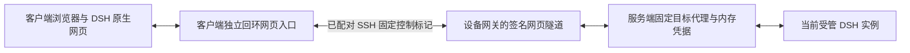

# 远程 DSH 原生网页转发

本文说明把服务端 DSH（代理执行宿主）的 Web UI（网页界面）整体交给已配对客户端浏览器使用的实现。2026-11-21：构建 product-13a9e7fcf1fa5975 已安装到两端，包含刷新连接复用与插件全局模型配置统一。隔离 SSH（安全外壳协议）、网页协议及正式 DSH 0.2.1-rc.5 真实浏览器验证通过；真实局域网双机的正式按钮、浏览器启动、多网页复用与持续鉴权通过，用户已确认两个网页及项目插件设置均能打开。本轮进一步核验候选插件页面、正式全局设置表单和真实局域网连接复用，收尾后两端均恢复普通运行模式。客户端与服务端同步升级，当前协议校验失败时要求更新，不维护旧协议适配或自动降级。

## 产品行为与范围

客户端浏览器直接运行服务端提供的 HTML（网页文档）、JavaScript（网页脚本）、样式和插件模块。模型、插件宿主、工作区及业务执行继续属于同一个服务端 DSH 实例。多个标签页、浏览器和已授权设备连接该实例；打开网页不另外启动 DSH。

客户端需运行已配对的 Voice Terminal（语音终端）原生客户端，不安装 DSH、Python（后端解释器）或模型。工作台的“代理控制台”按钮在服务端 DSH 就绪后启用，由客户端原生程序打开系统默认浏览器。

网页内容、业务消息、路径与查询保持上游实现。项目只负责设备授权、登录交接、固定目标传输及生命周期；不单独实现会话、设置、审批或每个插件的业务接口。

## 传输结构

沿用现有公钥的 restrict（受限登录）策略及主机指纹校验，只使用已有控制标记和受管动态网关。没有新增任意端口转发权限、固定控制台端口或系统网络规则。

客户端用 Hyper（网页协议实现）处理普通请求、持久连接和升级；服务端用 h11（网页协议状态机）解析内层交换并流式转发。同一浏览器连接按顺序复用已签名的受限隧道，空闲八秒回收，减少每项网页资源重复建立 SSH（安全外壳协议）连接的开销。响应正文完整结束后才可复用，正文被丢弃或流错误即关闭该隧道。服务端逐次检查来源、授权与固定目标，每次内层请求独立连接 DSH 回环端点；协议升级后转为双向字节流。外层 WebSocket（双向实时连接）只承载有界二进制块，不改写 DSH 业务消息，不自动重发业务请求。

## 正式入口与契约

| 入口 | 中文说明 |
| --- | --- |
| device_ssh_dsh_console（原生命令） | action（操作）为 open（打开默认浏览器）、status（查询本机入口）或 stop（停止本机入口）；在正式命令注册表及主窗口权限登记 |
| POST /v1/dsh-console（签名会话接口） | action（操作）为 open（申请授权）、status（续期并查询）或 close（撤销授权），protocol_version（协议版本）固定为 1 |
| GET /v1/dsh-console（签名升级接口） | console_session_id（控制台会话编号）作为唯一查询字段，同时进入签名主体；升级后传送原始网页协议 |
| 本机一次性引导路径 | 由当前监听器生成并交给系统浏览器，不由产品网页提交任意网址，不返回调试回执或日志 |

打开会话的 browser_origin（客户端网页来源）必须是规范的 IPv4（第四版网络协议）回环地址及实际端口。查询、关闭和升级使用 console_session_id（随机会话编号），编号不替代设备签名。所有接口通过当前设备网关实际监听器的内部标记检查，普通语音服务端口不开放这些路由。

新增原生命令、服务路由和调试目录使用同一正式注册与分发，不维护第二套调试业务入口。控制台授权独立于麦克风、语音交互占用及桌面任务租约。

Windows（操作系统）的 SSH 登录与交互桌面使用不同登录会话。固定桥接仅在查询当前端点期间，为本进程原 DACL（访问控制列表）临时追加当前账户 SID（安全标识符）的 PROCESS_QUERY_LIMITED_INFORMATION（有限进程身份读取）权限，查询成功或失败后都恢复原列表。桌面宿主继续严格核对查询进程的正式可执行文件；不新增写入、终止或其他账户权限。固定桥接拒绝原因由当前专用 SSH 连接有界收集，不混入网页或文件正文。

## 打开与认证流程

1. 用户点击客户端“代理控制台”。原生层核对正式产品窗口、已保存的配对目标与当前 SSH 连接。
2. 原生程序在 127/8（本机回环网段）内选择独立随机主机地址并绑定动态端口，申请与该来源及当前核心绑定的签名授权。
3. 服务端从 DSH 管理器取得当前实际地址、启动令牌与运行代次，通过回环请求完成一次登录。DSH Cookie（上游会话凭据）只保存在服务端会话内存。
4. 原生程序签发一分钟有效、只能消费一次的本机引导票据，调用系统默认浏览器。引导写入 HttpOnly（网页脚本不可读）、SameSite=Strict（严格同站策略）的本机凭据，再跳到干净根地址。
5. 每个浏览器请求先校验实际主机、来源及本机凭据，再经已配对 SSH 签名通道访问当前固定 DSH 目标。服务端附加自己持有的上游凭据。
6. 同一有效目标重复打开时复用本机入口，为新浏览器签发新的引导票据，允许多个网页同时连接。

随机端口只负责地址分配。浏览器 Cookie 不按端口隔离，因此客户端使用独立回环主机地址，避免普通 127.0.0.1 服务收到本机控制台凭据；同时仍执行逐请求来源和会话检查。规范依据见 [RFC 6265（会话状态规范）第 8.5 节](https://www.rfc-editor.org/rfc/rfc6265#section-8.5)。

上游认证凭据按请求的主机端口签发；接口接受回环主机名及同源来源。代理为客户端来源完成认证后可保留原始 Host（目标主机）和 Origin（请求来源），不需要修改网页正文或注入脚本。源码依据见锁定版本的[浏览器认证](https://github.com/deepseek-ai/deepseek-harness/blob/b830ec950faba0a46dda564be3e2d854afed94f1/packages/client/connection/src/browser-auth.ts)和[来源检查](https://github.com/deepseek-ai/deepseek-harness/blob/b830ec950faba0a46dda564be3e2d854afed94f1/packages/client/connection/src/api-request-trust.ts)。

## 插件、实时连接与附件

- 完整保留根路径和原始查询，包括 /plugins（插件资源路径）的组合脚本查询及修订参数。外层只登记固定隧道路由，内层不维护 DSH 接口或插件资源的逐项白名单。
- 网页业务的 /api/remote.mux（实时复用路径）按原生 WebSocket 升级并双向转发。压缩或二进制消息作为内层字节传输；热更新启用时的事件流也按流式正文处理。
- 上传、下载使用流式二进制正文，保留内容类型、下载文件名及业务缓存头。DSH 认证 Cookie 不下发客户端；插件自有 Cookie 可继续使用，项目和 DSH 的认证名称空间单独过滤。
- 浏览器选择的上传文件和下载目的地属于客户端。DSH 工作区、命令及服务端原生目录操作仍属于服务端，不自动改变插件执行位置。

本项目插件的[网页入口](../../integrations/dsh/voice-terminal/src/client/index.ts)通过 DSH 插槽接入设置分区和会话节点，随原站模块加载。标准网页插件可沿同源链路使用；另开独立端口、写死本机地址或依赖原生窗口的插件，需要按自身实现验证。

多个网页共用服务端 DSH 的浏览器所属身份、会话集合、插件与设置，不产生独立账户或工作区。上游有明确的[多标签页用例](https://github.com/deepseek-ai/deepseek-harness/blob/b830ec950faba0a46dda564be3e2d854afed94f1/packages/client/connection/tests/node-half.host.spec.ts#L854)。浏览器草稿及布局继续遵循上游本地存储；重启客户端或切换目标后来源变化，浏览器偏好不作迁移承诺。

完整网页具有 DSH 原生管理能力。项目插件的设备绑定、模型工具只读策略及逐次审批继续生效，但这些规则不把整套网页管理界面变成只读页面。

Voice Terminal（语音终端）插件的模型及推理强度与 DSH 共用 `agent-default-model`（全局模型设置）条目，选项由 `session.modelCatalog()`（正式模型目录接口）提供，不维护插件专属覆盖或等级枚举。新建语音会话读取当前全局选择，已有和恢复的会话保留原选择；详见[插件设置说明](../guides/dsh-console.md#voice-terminal-插件设置)。

## 生命周期与资源边界

- 当前授权最长八小时；原生客户端每十秒发送已签名状态心跳，服务端心跳租约为三十秒。
- 服务端始终运行独立授权监视，即使没有网页连接，设备撤销、重新授权、网关关闭、DSH 实例变化、租约或授权到期也会清除上游凭据并关闭活动通道。突发断线无法主动注销时，由心跳租约回收。
- 原生端绑定打开时的已配对连接对象，断开、重新连接、切换目标及退出会停止旧入口。正常停止主动撤销服务端会话；浏览器标签关闭不终止服务端 DSH。
- DSH 停止、异常退出、重启或维护停机均清理旧控制台授权；重新打开解析新实例，不凭端口相同恢复旧授权。
- 已发送的工具、设置或附件写入不因断线、超时或失去回执自动重放。撤销阻止继续访问，不回滚已提交业务。
- 单方向正文上限 4 GiB（四吉二进制字节），外层消息为 64 KiB（六十四千二进制字节），请求头上限 32 KiB（三十二千二进制字节）；流式传输有背压和停止检查。
- 每个服务端会话最多十六条活动隧道，客户端最多三十二条网页连接，服务端最多三十二个会话。首部读取、连接、引导及慢写入均有边界。
- 日志只记录脱敏状态及异常类别，不记录启动令牌、引导票据、凭据、网页或附件正文。

## 源码落点与验证

| 部位 | 文件与职责 |
| --- | --- |
| 服务端代理 | [console.py](../../voice_terminal/dsh/console.py)：目标快照、内存凭据、授权监视、HTTP 与升级字节流 |
| 受管生命周期 | [runtime.py](../../voice_terminal/dsh/runtime.py)、[device_gateway.py](../../voice_terminal/server/device_gateway.py)：实例变化、网关关闭及退出回收 |
| 正式设备入口 | [http_api.py](../../voice_terminal/server/http_api.py)、[trust.py](../../voice_terminal/devices/trust.py)：路径、签名挑战、会话及撤销检查 |
| 原生网页入口 | [dsh_console.rs](../../apps/desktop/common/src/dsh_console.rs)：回环主机、浏览器凭据、完整网页及多连接 |
| 固定传输 | [ssh_device.rs](../../apps/desktop/common/src/ssh_device.rs)：授权绑定、专用 SSH 连接与签名升级 |
| 产品入口 | [main.rs](../../apps/desktop/src-tauri/src/main.rs)、[commands.rs](../../apps/desktop/src-tauri/src/commands.rs)、[ProductApp.vue](../../apps/frontend/src/product/ProductApp.vue)、[useProductAdapter.ts](../../apps/frontend/src/product/useProductAdapter.ts) |

后端验证见 [test_dsh_console.py](../../tests/test_dsh_console.py)，覆盖插件组合查询、二进制附件、并行请求、来源、跨设备、签名、撤销、心跳及到期回收。原生网页模块中的跨层测试使用真实固定标记 SSH 服务和正式设备网关；开启 VOICE_TEST_REAL_DSH_BROWSER（真实宿主浏览器验收开关）后，再加载当前锁定的正式 DSH 运行包及项目插件，用 Playwright（浏览器自动化）验证两个网页、插件设置、原生实时连接与刷新。

连接复用回归还覆盖同一浏览器连接上的网页和二进制传输不新增 SSH 连接、八秒空闲回收、连续中断大正文下载后仍可打开网页。真实客户端 192.168.253.122 在两端普通模式下，通过保存的配对身份和同一正式原生实现，对 38,882 字节原站文档连续读取五次：优化前为 682、741、618、653、646 毫秒，优化后为 584、9、11、7、8 毫秒。首个请求仍包含建连，后四次复用平均 8.75 毫秒；采样只统计文档完整传输，不等同于浏览器整页渲染时间。原始回执保留在受管本机报告目录。

测试使用[隔离网关夹具](../../tests/fixtures/dsh-console-e2e-server.py)、[真实宿主夹具](../../tests/fixtures/dsh-console-real-host.mjs)和[浏览器检查](../../tests/fixtures/dsh-console-browser-check.mjs)，数据放在受管独占目录。不会启动正式用户会话、调用模型或修改现用 DSH 资料。

本轮双机现场已确认正式按钮、默认浏览器、多网页与项目插件设置；断线、撤销和重启的完整边界由隔离跨层回归覆盖，未另将所有异常场景登记为双机人工验收。网页入口结论也不覆盖模型实际执行远端桌面、终端和文件任务。组件版本和同步升级沿用[兼容性组件](compatibility-component.md)及[本地覆盖发布](../guides/local-layout.md)；使用说明见[DSH 控制台指南](../guides/dsh-console.md)。
