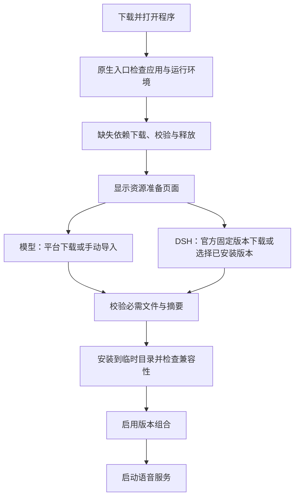

# 下载与分发规划及来源核验

核验日期：2026-10-07。本文保留上游来源核验及固定版本记录。当前 0.9.0 的启动、分发和依赖安装规则见[统一正式程序与分发安装器](unified-product-installer.md)、[必需组件更新](model-resource-updates.md)及[当前交付](current-release.md)；下文“尚未实施”和建议代表开始实现前的历史状态。

2026-10-10 已实施的组件规则为：新安装按当前随包清单，旧组件卡片提供“更新、导入、跳转”；任何必需组件缺失、损坏或待更新时均阻止整体语音服务启动。FSMN-VAD（语音活动检测）的未量化 ONNX（开放神经网络交换格式）导出资产已作为当前组件的必需文件随本体携带，新增轻量依赖组；处理器模式按新版策略自动选择该模型。更新完成并核验所有组件后才允许使用，不提供旧版推理适配。模型及环境的下载量按已验证文件复用扣减。

## 结论与维护范围

按三类划分维护责任可行：本体由项目维护；固定语音模型直接从原作者平台下载或由用户导入；DSH 直接使用经过项目验证的官方固定版本。发布时仍可把本体拆成多个物理下载包，避免每次更新重复下载运行环境。

| 类别 | 包含内容 | 来源与更新原则 |
| --- | --- | --- |
| 项目本体 | 根 EXE（可执行启动程序）、桌面页面、后端程序、Python（后端运行环境）及锁定依赖、项目自己的 DSH Bridge（语音通信插件）、任务插件与预设 | 源码公开到 GitHub（代码托管平台）；构建后的应用与运行环境作为独立 Release assets（版本附件）发布；运行环境标识未变时复用 |
| 语音模型 | 唤醒、流式识别、语音检测、结束判断、整句精修与声纹的静态资产 | 维护版本、必要文件、大小、摘要与来源的资源清单；默认直接上游下载，也支持同版本离线导入 |
| 官方 DSH | 官方客户端及随附执行环境 | 固定官方版本和文件摘要；通过专用适配器启动本项目隔离实例；升级先验证项目插件兼容性 |

本体中的 Python 环境建议继续由构建机生成闭合的运行环境包，客户机下载后释放。客户机不应临时解析最新依赖、运行源码构建或安装全局环境。WebView2（桌面网页渲染运行时）属于本体启动依赖，优先检测系统可用版本；若沿用固定运行时，继续作为独立包下载和复用。

当前根 EXE 是启动入口，实际程序位于 `apps/<构建标识>`，因此正常更新需要更新整个应用组件目录。只替换根 EXE 不会同步更新后端、页面和项目插件。

## 项目已有能力与需要调整的入口

现有分发代码已经包含按文件大小与 SHA-256（文件摘要）校验、物理版本目录、临时目录、ZIP（压缩归档）路径约束及本地启用记录，可以继续使用。

- `scripts/assemble-desktop.py`（桌面分发组装脚本）当前收集六个模型目录为一个完整组件；独立下载需要增加逐资源清单及组合记录。
- `voice_terminal/distribution.py`（发行文件校验模块）要求文件集合与清单一致；上游缓存目录、训练权重、样例文件不能混入正式模型安装目录。
- `apps/desktop/common/src/lib.rs`（共享启动上下文）目前会提前解析必需组件路径。需要新增资源未就绪状态，让安装准备流程先运行，再进入业务启动。
- `voice_terminal/model_setup.py`（基础模型安装模块）中的 ModelScope（魔搭模型平台）下载未指定版本和白名单；WeSpeaker（声纹模型）仍使用可变的 `resolve/main`（主分支资源地址）。
- `voice_terminal/analysis/model_setup.py`（分析模型安装模块）已锁定 Hugging Face（模型托管平台）提交号，但仍需统一预期文件摘要、下载任务与离线导入。

## 模型来源与固定版本

下面的上游元数据已与现用模型基线核对。HF（Hugging Face 平台简称）使用完整 commit（提交号）；ModelScope 本次核验得到固定 tag（版本标签），同时锁定各文件 SHA-256，不能把它描述为已确认完整提交号。

| 模型与用途 | 平台 | 固定版本 | 第一版文件白名单 |
| --- | --- | --- | --- |
| Sherpa KWS（关键词唤醒模型） | GitHub | `kws-models` 标签下的 `sherpa-onnx-kws-zipformer-zh-en-3M-2025-12-20.tar.bz2`（固定压缩包） | 第一版保留现用模型组合；精简前先显式锁定编码器、解码器和连接器文件名 |
| Paraformer（流式语音识别） | ModelScope | `iic/speech_paraformer-large_asr_nat-zh-cn-16k-common-vocab8404-online@v2.0.5` | `model.pt`（权重）、`config.yaml`（配置）、`configuration.json`（结构配置）、`am.mvn`（声学均值）、`seg_dict`（分词字典）、`tokens.json`（词元表） |
| FSMN-VAD（语音活动检测） | ModelScope | `iic/speech_fsmn_vad_zh-cn-16k-common-pytorch@v2.0.4` | `model.pt`、`config.yaml`、`configuration.json`、`am.mvn`；含义同上 |
| SmartTurn（语音结束判断） | HF | `pipecat-ai/smart-turn-v3@f766f81d3cfdf7737ac64aad813d91bbfd56bf93` | `smart-turn-v3.2-cpu.onnx`（中央处理器推理文件）；可选 `smart-turn-v3.2-gpu.onnx`（显卡推理文件），同时保留中央处理器回退 |
| SenseVoiceSmall（整句语音精修） | HF | `FunAudioLLM/SenseVoiceSmall@3847d57b6bdf2dd8875cb1508d2af43d80a16bf7` | `model.pt`、`config.yaml`、`configuration.json`、`am.mvn`、`chn_jpn_yue_eng_ko_spectok.bpe.model`（多语分词模型） |
| WeSpeaker（声纹模型） | HF | `Wespeaker/wespeaker-cnceleb-resnet34@c2c6282460dd5958d8eec16785f035d92e4a2d77` | 仅 `cnceleb_resnet34.onnx`（声纹推理文件）；无需训练权重 `avg_model.pt` |

Paraformer 的六个必需文件在 `v2.0.5` 和 `v2.0.4` 均与现用基线匹配；本文选 `v2.0.5`。FSMN-VAD 的四个必需文件在 `v2.0.4` 与基线匹配。元数据比对不等同于完整下载及推理验收。

KWS 压缩包的 GitHub 官方附件元数据已核验：32,885,699 字节，SHA-256 为 `68447f4fbc67e70eee3a93961f36e81e98f47aef73ce7e7ca00885c6cd3616a6`，与现用来源记录的压缩包摘要一致。本次没有重新下载压缩包。来源见 [GitHub 官方附件元数据](https://api.github.com/repos/k2-fsa/sherpa-onnx/releases/tags/kws-models)。

以下属于项目生成物，需要在资源准备环节处理：

- SmartTurn 的 `preprocessor_config.json`（特征预处理配置）由锁定依赖中的 `WhisperFeatureExtractor(chunk_length=8)`（Whisper 特征提取器，块长度为 8）生成，不能作为上游仓库文件下载；建议由本体携带经过校验的固定配置。
- KWS 用户唤醒词文件由用户设置生成，放在用户数据/缓存目录，不作为固定模型文件。
- 可选 FSMN-VAD ONNX（开放模型交换格式）资产由本项目导出，必须绑定原权重摘要并保留数值验证记录；不能假定 ModelScope 白名单中存在该文件。

## Hugging Face 与 ModelScope 的拉取方式

第一版按平台使用合适的下载路径：Hugging Face（抱脸）固定提交的 `resolve`（资源解析）地址经扩展后的 DesktopUpdateKit（桌面下载组件）资源接口传输；ModelScope（魔搭）在独立工作进程中使用固定 revision（修订号）和精确文件白名单的 SDK（软件开发库）。本体运行环境已锁定 `huggingface-hub==1.30.0`、`hf-xet==1.6.0`、`modelscope==1.39.1`、`modelscope-hub==0.4.0`；HF SDK 保留用于元数据和受控小文件操作。

HF 资源使用包含完整提交号的 `resolve/<commit>/<file>`（固定提交资源地址），由 DesktopUpdateKit 资源接口执行标准 HTTPS（安全传输协议）重定向、范围传输及摘要校验；不克隆整个仓库，也不直接实现 Xet（内容寻址大文件存储）CAS（内容寻址存储）协议。SDK 的 `hf_hub_download`（单文件下载接口）和 `snapshot_download`（快照下载接口）仍适用于受控元数据或小文件操作，必须传入完整 `revision`（修订号）并限制文件白名单。接口说明见 [HF 官方下载指南](https://huggingface.co/docs/huggingface_hub/en/guides/download)。

固定 `resolve`（资源解析）请求会跟随上游重定向，不保存带签名的临时 CDN（内容分发网络）地址；Xet 后端不改变本项目通过固定 HTTPS 地址访问资源的契约。本次 SmartTurn 和 WeSpeaker 范围探测各读取 1,024 字节并得到标准 206（部分内容响应），只证明了这些端点的 HTTP（超文本传输协议）兼容性；正式下载仍以资源清单中的固定大小和 SHA-256（文件摘要）验收。

ModelScope 使用独立 SDK 工作进程，并传入固定模型版本与精确文件白名单，输出进度后再由本体资源事务校验和安装。此前对单文件 URL（网址）的范围探测返回 200（成功响应）并带 `Content-Range`（响应字节范围），所以此处不把它交给依赖严格 206（部分内容响应）的通用原生传输器；官方开发库说明见 [ModelScope Hub 官方说明](https://github.com/modelscope/modelscope_hub)。

HF 资源下载到工作区内的任务暂存目录，验证后由资源事务原子安装；ModelScope SDK 的缓存和临时文件也限定在工作区缓存与任务目录。这样避免默认把完整权重同时留在平台中心缓存和正式模型目录。若将来启用共享中心缓存或 SDK `local_dir`（指定本地目录）模式，仍需单独计算额外空间和缓存预算；发布目录只收集本体自身清单，不包含用户模型。

当前资源已验证可匿名访问，默认显式禁用访问令牌。提供官方直连、用户网络代理和手动下载入口；不同平台的镜像节点需分别配置。已有 GitHub 加速网址模板不能直接套到 HF、ModelScope 或 DeepSeek 官方分发域名。

## 官方 DSH 的核验与接入边界

本项目现有锁文件为 `config/dsh/runtime.lock.json`（DSH 运行版本锁）：版本 `0.2.0-rc.2`，源码标签 `dsh-v0.2.0-rc.2`，提交号 `639ed015397290b3745d163aafe02ffee4aa3f84`。

该 [GitHub Release 附件页](https://github.com/deepseek-ai/deepseek-harness/releases/expanded_assets/dsh-v0.2.0-rc.2) 只有源码归档与证明文件，不能将源码 ZIP（压缩归档）作为可运行客户端。Windows（操作系统）客户端通过 DeepSeek 官方分发站提供。

已核验的固定官方安装器：

- 地址：[0.2.0-rc.2 Windows x64 安装器](https://download.deepseek.com/dsh-desk/bin/win-x64/deepseek-harness-0.2.0-rc.2-win-x64.exe)。
- 大小：289,313,640 字节，HEAD（仅取响应头）请求成功且长度匹配。
- 官方 feed（版本订阅清单）：[win-x64/nightly.yml](https://download.deepseek.com/dsh-desk/feeds/win-x64/nightly.yml)，核验时指向此版本；本项目发布记录应保存固定安装器地址和摘要，不在运行时跟随可变订阅。
- SHA-512（文件摘要算法），Base64（编码）表示：`raIlxMQd9ESXgktmViW7QwVLcjBR5JIsrNOu+SpelY8kskdSr2H51/f+ey1EqFI/eIIrKQCuRANMeb5SptRZcg==`。

官方订阅清单没有提供源码提交号。本次确认的是版本号与项目锁相符，以及固定文件的响应长度；没有完整下载安装器、计算其摘要或检查内嵌构建号，不能据此宣称已确认二进制来自锁定的源码提交。

官方客户端包含 CLI（命令行入口）与执行环境，可以通过 `dsh web`（启动代理网页服务）运行独立实例。应使用项目独立的 `DSH_HOME`（代理数据目录）、本机地址、明确端口与 `--no-open`（不自动打开浏览器）。命令入口见 [锁定版本的 Desktop README（桌面客户端说明）](https://github.com/deepseek-ai/deepseek-harness/blob/639ed015397290b3745d163aafe02ffee4aa3f84/apps/desktop/README.md)。

当前项目正式运行包使用物理 `node.exe`（脚本运行程序）、入口脚本、`node_modules`（依赖目录）、调度模块路径和自有运行清单。官方 Desktop（桌面客户端）的核心位于 ASAR（Electron 桌面框架归档），启动方式及依赖解析不同，不能原样替换当前运行目录。

专用适配器至少需要核验：官方命令启动、本项目插件加载、`DSH_HOME` 下依赖链接、调度模块解析、文档处理所需的原生组件、受管子进程退出及版本检查。官方客户端自身的安装和用户更新也需要与项目正在运行的实例协调；不能假定官方安装器支持当前便携目录或可安全直接解压。第一版先验证官方安装后的路径发现与版本识别，再决定是否支持独立版本副本。

上游另外存在构建独立 SDK（开发库）运行程序的流程，但本次未发现与 `0.2.0-rc.2` 匹配的已发布 Python（编程语言）运行包，不能把构建流程视作已可下载的发行附件。NPM（脚本依赖仓库）的 CLI 小包也不是完整独立客户端。当前以官方桌面客户端加专用适配器作为候选，现用 DSH 运行包保留到实机适配通过。

## DesktopUpdateKit 的复用与最小扩展

核验源码版本：`8bfb24c1770098f6bd68aef208fcdfa1f097b92b`。

当前 v1（第一版协议）服务于 Windows 单 EXE 更新：固定 GitHub 附件、EXE 文件头、SHA-256 与单文件替换。下载会话具有范围并发及进程内暂停/继续；退出或取消后不保留断点，不能宣称已支持跨进程续传。见 [行为约定](https://github.com/wet86y/DesktopUpdateKit/blob/8bfb24c1770098f6bd68aef208fcdfa1f097b92b/docs/BEHAVIOR_CONTRACT.md) 和 [下载架构](https://github.com/wet86y/DesktopUpdateKit/blob/8bfb24c1770098f6bd68aef208fcdfa1f097b92b/docs/DOWNLOAD_ARCHITECTURE.md)。

建议在共享下载器中增加独立的通用资源任务入口，保留原 EXE 更新约定：

1. 接受固定 HTTPS（安全传输协议）地址、目标路径、预期大小和摘要；支持普通模型及压缩包，不强制 EXE 文件头，也不强制 GitHub 资源来源。
2. 支持 SHA-256 与 SHA-512，明确摘要编码，接收官方 DSH 文件摘要。
3. 为大文件增加跨重启断点记录，绑定固定资源标识、版本、大小和摘要；单连接与分段模式均检查响应边界。
4. 支持跨域重定向、超时和重试；不将带签名的临时地址作为持久资源身份。
5. 对标准分段不成立的服务器退回完整单连接；平台特殊行为放在对应适配器中处理。
6. 提供 Rust（桌面原生语言）可调用的适配接口，或复用现有原生库提供窄接口；不引入新的常驻下载服务。

共享下载器负责传输、进度与摘要。项目负责版本组合、资源清单、模型 SDK 任务、解包、导入、激活和应用健康检查。多文件应用更新不能直接使用现有单 EXE 替换器。

## 资源目录与发布信息

建议先随本体携带固定资源清单；后续可把“小型资源目录”发布到 GitHub，用于通知可选更新与提供来源。资源目录只更新项目已认可的版本组合，不能把上游最新版本直接当作本项目更新。若目录后续可独立改变可执行资源或下载源，需要使用内置受信任密钥验证目录签名。

以下是拟议字段，不是已实现接口：

| 字段 | 中文说明 |
| --- | --- |
| `schema_version` | 资源清单格式版本 |
| `resource_id`、`category` | 稳定资源编号、所属维护类别 |
| `platform`、`repo_id`、`revision` | 下载平台、仓库标识、固定修订号 |
| `url` | 固定资源地址；用于普通文件/压缩包 |
| `files`、`path`、`size_bytes` | 必需文件列表、安装相对路径、预期字节数 |
| `hash_algorithm`、`hash_encoding`、`hash_value` | 摘要算法、十六进制或 Base64 编码、预期摘要 |
| `destination`、`install_layout` | 安装根目录及来源目录到本地目录的映射 |
| `compatible_app_versions` | 本项目认可的应用版本范围 |
| `generated_assets` | 由本体携带或在准备阶段生成的资产 |
| `license_url`、`source_url` | 上游许可证说明和原始发布页面 |

状态记录应放在用户数据目录，记录本机已安装版本及任务进度；发布清单不包含开发机绝对路径、用户密钥或临时签名地址。模型许可证说明应保留来源链接；本体采用开源许可不自动改变上游模型许可。

## 用户安装与更新流程

首次下载必须由不依赖 Python 的原生入口执行。模型 SDK 已在本体运行环境里，只有先准备完 Python 运行环境才能使用；如果桌面界面依赖 WebView2，入口也需要先检查/补齐渲染依赖。

在线下载与手动导入共用同一份版本清单和校验流程。用户选择目录或归档后，识别必需文件、报告缺失/版本不符项，校验成功后安装到项目管理目录；不凭同名文件、存在权重或自生成摘要判定合格。

同一磁盘使用临时目录和原子切换；不同磁盘先复制并校验，再完成导入。不要让部分下载覆盖现用模型。更新应用时只下载应用与发生变化的本体运行包；不重新下载未变的模型和 DSH。先下载和验证，激活前再协调退出需要替换的服务。

当前历史包的主要体积来自 Paraformer 约 881 MB（十进制兆字节）与 SenseVoiceSmall 约 936 MB；分开下载可以降低初始程序包和日常更新体积，但完整功能首次准备仍需要这些权重。不能把去除样例文件描述为消除大型模型的下载量。

## 实施顺序与核验记录

建议实施顺序：

1. 固化资源清单与文件白名单，补齐离线导入和现有模型校验。
2. 扩展 DesktopUpdateKit 通用资源入口，接入应用包及本体运行环境下载；先打通无环境的首次启动。
3. 接入独立模型下载工作进程，复用现有 HF/ModelScope SDK，提供统一任务状态、失败重试和可恢复任务。
4. 用官方 DSH 安装后的客户端完成独立适配验证；通过后再将它作为正式默认来源。
5. 增加兼容版本目录、发布自动化与完整应用更新回退流程。

本次实际完成：项目及共享下载器源码审阅；上游固定版本与文件摘要元数据比对；HF 两个模型的少量范围读取；HF 与 ModelScope 各一个配置文件在中文/空格路径的匿名 SDK 下载，摘要与现用基线匹配；DSH 固定安装器响应头和官方摘要核验；KWS 官方附件摘要核验。

本次没有完成：完整权重下载及推理对照、DSH 官方安装和插件联调、DesktopUpdateKit 通用资源传输、跨重启续传、干净 Windows 客户机的首次启动验收。上述事项列为实施后的验收范围，不能从当前轻量探测推定通过。

本机详细证据位于 `.runtime/distribution-review-20261007`（已忽略的核验工作目录），包含模型平台报告、DSH 官方运行形式报告、小文件下载记录及所审阅的共享下载器源码。业务代码与当前运行配置未由本次规划修改。
