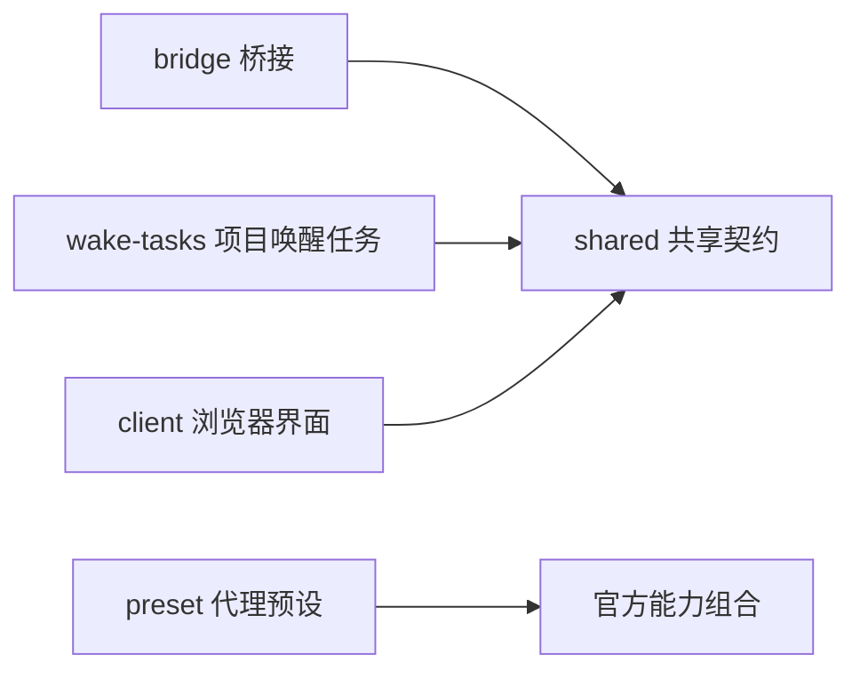

# 项目内 DSH 插件维护手册

本手册维护项目内 DeepSeek Harness（DSH，代理执行宿主）集成。唯一安装包为 `@voice-terminal/dsh-plugin`（语音终端功能包），项目插件版本为 `0.2.0`，桥接协议版本为 `2.0`。上游宿主锁定 `dsh-v0.2.0-rc.2`（候选版），提交号 `639ed015397290b3745d163aafe02ffee4aa3f84`；三种版本分别管理，不以插件版本推断宿主或协议版本。

源码唯一入口是 [`integrations/dsh/voice-terminal/`](../integrations/dsh/voice-terminal/README.md)。运行源码、产物和数据分别位于项目 `.runtime/dsh/source`（官方源码）、`.runtime/dsh/bundles/voice-terminal`（统一插件产物）及 `.runtime/dsh/home`（项目数据目录）。本流程不安装或维护用户级 DSH，不变更语音端的后端选择，也不发布桌面程序。

## 组件职责与边界

`components.json`（组件声明）使用 `schema_version`（声明格式版本）、`id`（组件标识）、`description`（中文职责）、`entry`（源码入口）、`runtime_entry`（安装产物入口）、`loader_id`（宿主加载行标识）和 `depends_on`（组件依赖列表）。源码入口用于维护检查，运行入口用于发布闭包检查；安装产物不包含 TypeScript（静态类型语言）源码。

| 组件 | 源码入口，相对于插件目录 | 负责内容 | 生命周期所有者 |
| --- | --- | --- | --- |
| `bridge`（桥接） | `src/bridge/plugin.ts` | 会话绑定、上下文合并与门禁、8 个桥接工具、回执、观察、工作区及模型设置 | 桥接插件上下文及绑定的根代理 |
| `wake-tasks`（项目唤醒任务） | `src/wake-tasks/plugin.ts` | 8 个任务及语音事件工具、任务接口、持久化、旧项目任务迁移、定时投递 | 任务插件上下文及任务服务 |
| `client`（浏览器界面） | `src/client/index.ts` | 设置页、消息渲染、语言资源和界面插槽 | 浏览器插件上下文及服务期间注册 |
| `preset`（代理预设） | `preset/shadow-agent/agent.cordis.yml` | 官方工具、压缩、子代理及工作流的完整组合 | 官方代理预设注册器 |
| `shared`（共享契约） | `src/shared/protocol.ts` | 协议、稳定标识、鉴权、网络传输、取消作用域、设置契约、生成提示词 | 使用它的组件 |



桥接与任务组件没有互相导入。共有鉴权、回环地址约束和传输实现只维护一份；任务组件通过公开语音接口取得当前语音会话。浏览器只使用共享类型和设置契约，不导入宿主运行实现。组件依赖必须先声明，构建检查会拒绝未声明依赖、循环依赖和缺失入口。

一次安装只登记一个功能包。`host.patch.yml`（宿主组合补丁）保持两个独立加载行：根包入口加载桥接，`./wake-tasks`（任务子入口）加载任务组件。构建再合入 `preset-shadow-agent`（预设加载行）。只有根包声明 `dsh.client`（浏览器模块元数据），避免任务子入口重复注册设置页。

## 必须保持的兼容契约

| 契约 | 保留值及维护要求 |
| --- | --- |
| 加载行 | `voice-terminal-shadow-bridge`（桥接行）、`voice-terminal-wake-tasks`（任务行）、`preset-shadow-agent`（预设行）；包名变化不能改变行标识 |
| 设置命名空间 | `voice-terminal-shadow-bridge`（桥接设置）；保留已有工作区、模型、推理强度和恢复提示 |
| 消息来源 | `plugin:voice-terminal-shadow-bridge`（桥接消息来源）；语音端和客户端依赖此值 |
| 预设标识 | `shadow-agent`（影子代理预设）；保持原有官方默认工具、压缩、子代理及工作流能力 |
| 网络接口 | `/api/voice-terminal-shadow/v1`（桥接接口）、`/api/voice-terminal-wake/v1`（任务接口）、`/api/internal/dsh-bridge/`（语音回调前缀） |
| 任务存储 | `storages/voice-terminal-wake-tasks.json`（项目任务文件）；`schema_version: 1`（存储格式版本）、`tasks`（任务记录）、`deleted_task_ids`（删除确认标识） |
| 会话映射 | `.runtime/dsh/session-mappings.json`（语音与 DSH 会话映射）；`schema_version: 2`（映射格式版本） |
| 桥接信封 | `protocol_version`（协议版本）、`request_id`（幂等请求标识）、`voice_session_id`（语音会话标识）、`dsh_session_id`（DSH 会话标识）、`epoch`（会话世代） |
| 激活与上下文 | `activation_id`（激活标识）、`context_revision`（上下文版本）；过期调用必须保持拒绝，不能用新激活替代旧请求水位 |
| 实时运行轨迹 | `shadow.activity`（内部活动回调）的 `action_seq`（动作序号）在激活内递增，思考、工具和运行状态串行发送；`activity`（实时活动正文）只使用绑定根代理的公开实时流及工具事件，字段与拒收规则见 [桥接活动协议](bridge-2.0-protocol.md) |

8 个桥接工具为 `get_latest_context`（读取权威上下文）、`read_ambient_context`（读取旁路文字）、`publish_progress`（发布进度）、`publish_voice_information`（发布可替换信息）、`request_early_silence`（请求提前静默）、`request_user_input`（请求用户澄清）、`return_shadow_result`（提交终态结果）、`finish_shadow_no_action`（终态无需动作）。仅安装到已绑定的根代理，子代理不能通过伪造会话标识调用。

8 个任务工具为 `schedule_wake`（简易创建）、`cancel_wake`（取消）、`read_wake_reference`（按需读取冻结参考）、`publish_voice_event`（发布语音事件）、`wake_task_create`（创建）、`wake_task_list`（查询）、`wake_task_update`（更新）、`wake_task_delete`（删除）。保留完整任务标识、历史、删除确认、写入失败恢复及重启恢复。

以下行为不得在结构整理中改变：

- 终结型桥接工具仅在回执 `accepted`（接受）或 `duplicate`（重复已接受）时调用 `exec.concludeTurn()`（结束当前回合）；拒绝、过期或失败回执继续按原规则处理。任务事件发布同样遵循确认后结算规则。
- 进度继续登记二等信箱，由语音端在 4 秒检查点或普通请求中评估；信息和终态通过普通事件路径处理。DSH 的普通助手文字不会自行转成播报。
- 长推理的 20 秒软提醒通过下一步安全边界注入，不唤醒空闲代理，不中断工具；终态或解绑后停止。
- 设置更改作用于下一次新建语音会话；恢复会话继续保留原会话选择。失效工作区或模型按原规则回退并展示提示。
- 项目任务只迁移旧语音任务，不读取官方会话调度存储。冻结参考由读取工具按需取得，不自动加入模型上下文。

## 依赖与官方规范

规范以锁定提交的官方源码为准，不照搬其他版本的例子。主要依据是 [官方开发约定](https://github.com/deepseek-ai/deepseek-harness/blob/639ed015397290b3745d163aafe02ffee4aa3f84/AGENTS.md)、[包维护约定](https://github.com/deepseek-ai/deepseek-harness/blob/639ed015397290b3745d163aafe02ffee4aa3f84/packages/AGENTS.md)、[插件发布文档](https://github.com/deepseek-ai/deepseek-harness/blob/639ed015397290b3745d163aafe02ffee4aa3f84/docs/user/develop/basic/publish.md)、[工具添加指南](https://github.com/deepseek-ai/deepseek-harness/blob/639ed015397290b3745d163aafe02ffee4aa3f84/docs/cookbook/adding-a-tool.md)、[防御模式](https://github.com/deepseek-ai/deepseek-harness/blob/639ed015397290b3745d163aafe02ffee4aa3f84/docs/defensive-patterns.md)、[浏览器维护约定](https://github.com/deepseek-ai/deepseek-harness/blob/639ed015397290b3745d163aafe02ffee4aa3f84/packages/client/AGENTS.md)和[界面插槽规范](https://github.com/deepseek-ai/deepseek-harness/blob/639ed015397290b3745d163aafe02ffee4aa3f84/docs/subsystems/slots.md)。

| 依赖类别 | 当前配置 | 维护原则 |
| --- | --- | --- |
| `dependencies`（普通运行依赖） | `@deepseek-ai/schemastery`（配置模式库）`~3.18.4` | 纯配置构建依赖；不要夹带第二套宿主服务 |
| `peerDependencies`（同宿主运行依赖） | Cordis（插件框架）`~4.0.4`，DSH 工具、调度、模型、会话和工作区包 `0.2.0-rc.2` | 使用宿主提供的包实例与公开导出；开发版本必须与同宿主版本一致 |
| `devDependencies`（开发依赖） | 上述同宿主包、公开服务类型、浏览器包、React（界面库）、TypeScript（静态类型语言） | 类型专用导入使用 `import type`（仅类型导入）；不能靠开发依赖掩盖实际运行导入 |
| `dsh.client.inject`（浏览器注入依赖） | 8 个官方会话、工作区、语言、基础控件、渲染、设置、会话消息及聊天包 | 只声明实际使用服务，不用跨界面包的值导入获取其他组件 |

项目复用公开 `@deepseek-ai/dsh-schedule`（调度规则库）的解析与时间计算，但不依赖官方 Automation（自动化功能包）处于启用状态。官方 `schedule_*`（会话调度工具）仍由官方可选功能包提供，与项目任务保持独立。安装迁移保留用户启用的官方功能包和其他自定义插件。

宿主插件遵守以下规则：

1. 导出命名的 `name`（插件名）、`inject`（服务依赖声明）、`Config`（配置模式）和 `apply`（装配函数）。必需服务声明在依赖中，可选服务通过 `ctx.get()`（上下文服务查询）取得。不要自行复制宿主对象。
2. 工具使用公开 `defineTool()`（工具定义函数），由模式推导参数与输出类型；使用公开标识构造函数，不把任意字符串强制转换成宿主会话、工作区或消息标识。
3. 锁定版本的工具模式语言不支持数值上下限、字符串长度和数组数量的额外关键字。范围放在中文描述并保留运行时边界校验；不要添加 `minimum`（数值下限）、`maxLength`（字符串长度上限）等不支持的模式字段。本轮保留了旧工具的边界语义。
4. 分开宿主与浏览器类型配置，保留严格类型检查、可选字段精确检查和索引越界检查。禁止 `any`（任意类型）和双重强制转换绕过服务契约。历史自由结构使用 `unknown`（待校验类型），先验证后使用。
5. 网络调用复用共享传输层，保留请求大小限制、身份校验、回环地址约束和超时。调用方 `AbortSignal`（取消信号）与组件取消信号共同生效。
6. 定时器、路由、事件监听、工具和代理都必须有生命周期所有者。解绑或卸载先停止新工作，取消并等待未完成回调。代理使用公开 `dispose()`（释放接口）；取消原因使用宿主规定的结构，不能以裸字符串冒充。
7. 不修改官方运行源码，不从宿主内部文件路径导入功能，不通过环境变量注入内部调度模块路径，也不解析私有会话文件代替公开接口。
8. 实时运行轨迹使用公开 `AssistantStreamFrame`（助手实时流帧）类型，按 `revision`（实时流修订号）与 `attemptId`（模型尝试标识）过滤旧流；思考刷新定时器、串行回调队列和网络请求均归属当前绑定，激活替换、解绑和卸载必须清理。该正文只供工作台固定单槽显示，不进入语音推理或长期历史。

浏览器组件使用 `inject.hooks`（可观测状态钩子注入），设置页从官方设置表单服务获得状态与变更入口，工作区使用官方状态钩子。页面、语言和渲染贡献随上下文释放；设置页通过 `whileServed()`（服务可用期间注册）跟随命名空间的存在。不自行使用 `useSyncExternalStore`（手动外部状态订阅）或额外状态镜像模拟官方钩子。

## 新功能与修改流程

1. 先确定所属组件以及用户可见行为。属于一个组件的功能留在该组件；确实跨组件共用的协议或无状态能力才进入共享目录。新增组件必须更新组件声明、依赖、运行入口和宿主组合补丁。
2. 明确输入、输出、拒绝条件、取消方式、幂等规则和数据所有者。每个新增英文专业名词及公开字段配中文说明；错误回执必须使调用者能区分拒绝、重试和已完成。
3. 检查包清单：实际运行导入必须属于普通或同宿主依赖，浏览器服务必须加入浏览器依赖声明，类型引用加入对应类型配置。不得为了消除类型错误放宽全局检查。
4. 工具修改验证根代理身份、旧激活拒绝、边界参数与终态结算；异步功能验证取消期间不继续发布。界面修改验证设置服务出现、撤下、再次出现时注册数量和清理。
5. 数据格式变更先设计版本判断、幂等迁移、失败回滚和旧记录保留。不能删除旧字段后再试图推断迁移。项目任务、原生会话任务和语音映射不得混用。
6. 增加能验证行为边界的回归。不要只用字符串匹配代替执行测试，也不要只用手工上下文组合替代真实加载器测试。加载器测试必须证明唯一安装包、完整预设、浏览器模块唯一注册和组件卸载清理。
7. 更新本手册与相应协议、操作文档，运行下列门槛后再安装。调整上游版本时同时检查版本锁、许可证、公开接口、包依赖和真实组合测试，不追踪浮动版本。

## 构建、验证与项目安装

以下命令在仓库根目录运行；使用已有锁定宿主源码及其依赖：

```powershell
npm --prefix integrations/dsh/voice-terminal test
python -X utf8 -m pytest -q tests/test_dsh_profile.py tests/test_dsh_preset.py tests/test_dsh_runtime.py tests/test_dsh_setup_backup.py
node integrations/dsh/voice-terminal/build.mjs
git diff --check
```

插件测试包含宿主和浏览器类型检查、组件与依赖检查、官方浏览器构建、原有桥接及任务回归，以及真实官方加载器的隔离组合测试。组合测试使用独占临时数据目录、随机回环端口和本地模型替身，不访问真实模型供应方，不读写生产任务。测试产物在 `.runtime/dsh/bundles/voice-terminal-test`（隔离测试包）；正式构建不包含测试专用依赖链接。

修改安装、配置迁移或摘要规则时，另执行 `python -X utf8 scripts/dsh-diagnose/plugin-install-smoke.py`（真实安装隔离检查）。它创建独立项目副本，执行旧三包迁移、重复安装和校验，并核对用户插件、原生自动化、设置、任务、映射及三端摘要。检查日志保留在项目 `.runtime/plugin-install-check-*`（隔离检查目录），不使用现有项目数据。

涉及协议、上下文、生命周期或公共事件时，另运行后端全量及前端测试、类型检查和构建，入口见[运行与质量门槛](operations-and-quality.md)。自动化通过不等同于真实模型、麦克风和播放设备的现场验收。

安装前按项目流程停止 Voice Server（语音服务）。安装脚本检查实际监听端口；服务仍在运行时会拒绝部署，不能改端口变量绕过正在使用的项目实例。

```powershell
pwsh -NoProfile -File scripts/setup-dsh.ps1 -Offline -SkipInstall
pwsh -NoProfile -File scripts/setup-dsh.ps1 -Offline -ValidateOnly
node scripts/dsh-diagnose/compare-build-state-hashes.mjs
node scripts/dsh-diagnose/upgrade-smoke.mjs
```

`-Offline`（离线模式）使用已存在的固定宿主和依赖缓存；`-SkipInstall`（跳过宿主依赖安装）仍构建并安装项目插件；`-ValidateOnly`（仅校验）不部署。缺少宿主依赖或需要升级宿主时使用完整安装流程，见[项目 DSH 基线](../config/dsh/README.md)。完成校验后按项目流程启动语音服务，并从受管入口打开控制台。

安装在修改前备份项目的配置、功能包、构建状态和会话映射；失败时恢复原组合。迁移用官方插件命令移除旧的桥接、任务和预设安装记录，再登记统一包。已有加载行仅更新 `name`（包名称）指向，保留 `config`（用户设置），预设默认项保持 `shadow-agent`（影子代理）。旧任务和会话文件不改名、不清空；原生自动化选择保留。备份和失败产物都保留在项目运行目录，确认验收后再依项目数据归档流程处理。

`build-state.json`（构建记录）格式更新为 `schema_version: 6`（格式版本），记录 `plugin_bundle_version`（统一插件版本）、`plugin_runtime_artifacts_sha256`（运行产物摘要）、`plugin_build_inputs_sha256`（构建输入摘要）、`shadow_prompt_sha256`（提示词摘要）及宿主身份。源码新鲜度检查覆盖全部组件源码、预设、清单、声明、构建和检查脚本、宿主补丁及两套类型配置；运行摘要覆盖包清单、生成补丁、组件声明和完整编译目录，包括源码映射。文档与测试不参与运行新鲜度判断。

公共提示词仍由 `config/shadow_agent/instructions.md`（公共指令）与 `config/dsh/shadow-agent.rules.md`（DSH 专属规则）按原顺序连接生成，不维护另一份手写运行提示词。新增运行文件必须进入编译目录或显式加入构建输入和运行摘要；PowerShell（安装脚本）、Python（运行校验）及 Node.js（诊断脚本）三处摘要算法必须一致。

## 维护完成标准

- 一个安装包、三个稳定加载行、一个浏览器模块；没有旧包重复登记或遗漏运行入口。
- 旧工具名、拒绝规则、回执语义、任务恢复、设置保存和完整预设能力均有执行测试覆盖。
- 类型与依赖检查通过；共享逻辑无重复；组件卸载后不遗留网络回调、计时器、路由或代理。
- 安装、重复安装及失败恢复可验证；用户插件、原生自动化、任务、会话映射和设置得到保留。
- 新功能的中文字段说明、行为回归及维护说明齐全；真实模型和设备验收与隔离测试的边界明确。

排障先检查构建状态、完整摘要和展开配置，再检查公开接口回执与加载器状态。日志只记录必要标识和错误；不得输出访问令牌、模型密钥、鉴权头或带令牌的控制台地址。历史审计中的旧目录和旧版本属于当时证据，当前维护以本手册和统一源码目录为准。

## 2026-10-07 插件合并与项目安装验收

桥接、项目唤醒任务及影子预设的三个安装包已合并为 `@voice-terminal/dsh-plugin`（统一功能包）`0.2.0`。原来分散的插件源码及预设配置已迁入统一目录；安装单位为一个功能包，内部保留三个稳定加载行和一个浏览器模块。共享协议、鉴权、网络传输与取消作用域只维护一份。

本轮按锁定宿主的公开契约调整工具定义、类型配置、浏览器状态钩子和生命周期释放，并修正代理释放接口、取消原因结构及工具参数边界声明。解绑后取消并等待后台回调；终态回执与工具名保持原语义。迁移测试还覆盖 Windows（操作系统）换行、重复迁移，以及离线移除旧包时包管理器的参数兼容。

项目 `.runtime/dsh/home`（项目数据目录）中的网页配置已通过正式安装脚本迁移，旧三个包的登记全部移除。`build-state.json`（构建记录）为格式版本 6，插件版本 0.2.0，桥接协议 2.0；上游宿主提交及版本未变化。安装前后核对的 117 个原有任务、工作区、会话及映射文件摘要一致。隔离项目另验证了原生自动化和自定义插件选择的保留。

| 验证范围 | 本轮结果 |
| --- | --- |
| 插件类型、组件依赖、官方浏览器构建与行为回归 | 33 项测试通过 |
| 真实官方加载器组合 | 完整预设、终态结算、浏览器唯一注册、幂等解绑及组件卸载通过 |
| 模型替身与客户端生命周期冒烟 | 首次接受、重复确认、回调失败后重试、设置页注册与释放通过 |
| 工作区后端全量回归 | 855 项通过、1 项跳过；记录的是当次工作区执行结果 |
| 工作区前端回归 | 164 项界面测试及 3 项启动脚本测试通过；类型检查与构建通过 |
| 隔离项目真实安装 | 旧三包迁移、重复安装、设置与数据保留通过 |
| 当前项目实际安装校验 | 安装脚本仅校验模式、Python（运行校验）及三端摘要一致性检查通过 |
| 差异与上游源码 | 差异格式检查通过，锁定官方源码工作区无修改 |

上述结果属于自动化与隔离验收。真实模型、麦克风和播报设备未进行现场验收。桌面发行包仍按独立发布流程管理；本轮完成项目内安装，没有重新发布便携程序。安装备份、测试日志和运行数据保留在项目忽略的运行目录，不纳入 Git（版本控制）提交。

## 2026-10-07 实时运行轨迹协议修订与构建

桥接活动端点已补充固定单槽的字段、拒收、取消和恢复规则，见 [Bridge 2.0（桥接协议）](bridge-2.0-protocol.md)。思考、工具和运行状态使用同一 `action_seq`（动作序号）与串行队列；公开实时流按修订号、模型尝试与原激活过滤迟到帧。激活替换、取消、解绑及卸载清理待发思考，解绑和卸载等待回调队列结束。工具只发送名称和状态，状态观察器摘要继续更新摘要及原有信息路径，不作为单槽思考正文。

已重新生成 `.runtime/dsh/bundles/voice-terminal`（统一插件产物），确认配置的 Voice Server（语音服务）端口无监听后执行 `setup-dsh.ps1 -Offline -SkipInstall`（离线安装且跳过宿主依赖安装），同步项目安装登记及构建记录。插件版本为 0.2.0，桥接协议为 2.0，构建记录格式为 6，锁定上游宿主版本和提交保持原值。

| 验证范围 | 本轮结果 |
| --- | --- |
| 插件回归、宿主及浏览器类型检查、组件依赖和真实加载器 | 40 项通过，包含 7 项实时活动回归 |
| 后端桥接、产品投影及 DSH 构建定向检查 | 77 项通过 |
| 当前工作区后端全量回归 | 899 项通过、1 项跳过；7 条既有网络库弃用提示 |
| 当前工作区前端回归及开发入口 | 169 项界面测试、3 项开发入口测试通过 |
| 前端类型检查与生产构建 | 通过 |
| 项目安装与运行摘要 | 安装脚本仅校验、Python（后端运行时）安装校验及三端摘要比对通过 |
| 安装后的隔离冒烟 | 终态接受、重复确认、回调失败重试与设置表单释放通过 |
| 原有数据及锁定上游源码 | 安装前后 115 个会话、存储和映射文件摘要一致，上游源码无修改 |
| 差异格式 | 通过 |

安装备份保留在 `.runtime/dsh/upgrade.backup-0.2.0-rc.2-20261007-195537-304`（安装前备份目录）。本轮完成项目内插件安装及前端构建，未发布桌面发行包；真实模型实时流、麦克风及播报设备仍待现场验收。新插件在项目 DSH（代理执行宿主）下次启动时加载。
