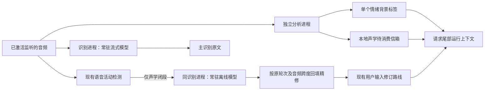

# 音频增强：双路精修、情绪背景与声学信箱

当前生产路径以 Paraformer（语音识别模型）的主流式稿为原文，由独立的离线模型、情绪模型和声学事件模型分别补充能力。SenseVoiceSmall（旧语音理解模型）不再进入生产加载、资源启动门禁、设备设置或组件列表。历史转写、旧延迟字段和报告仍可读取。

## 三项开关

产品设置文件中的 `audio_enhancements`（音频增强设置）保存三个独立布尔字段：

```json
{
  "audio_enhancements": {
    "dual_pass": true,
    "emotion": true,
    "acoustic_events": true
  }
}
```

| 字段 | 中文说明 | 界面位置 |
| --- | --- | --- |
| `dual_pass` | 双路精修 | Paraformer（语音识别模型）组件详情 |
| `emotion` | 情绪背景 | 扩展组件内 emotion2vec+ base（基础版情绪模型）详情 |
| `acoustic_events` | 声学事件信箱 | 扩展组件内 YAMNet（声学事件模型）详情 |

新安装默认全部开启。旧工作区没有这一分区时，先从 YAML（配置文件）的 `smart_turn.sensevoice`（旧精修总开关）迁移初值；以后由三个独立开关决定。持久化设置格式为第 16 版。旧 `compute.devices.sensevoice`（旧模型设备偏好）迁移为 `compute.devices.emotion`（情绪模型设备偏好），缺省为处理器。

运行中通过 `PUT /api/v1/product/settings/audio-enhancements`（统一保存接口）提交需要修改的字段，例如 `{"emotion":false}`。启动前管理页使用原生 `audio_enhancements_settings`（音频增强设置命令），读写同一个产品设置文件。

运行操作共用右下角转圈状态提示及自动暂停机制；语音合成切换、音色试听、样音播放和声纹现场采集也按操作前状态恢复监听。阶段契约及各入口的实际生效边界见[在线切换说明](runtime-switching.md)。

切换先校验参数及新增资源，然后立即撤销输入准入并停止监听，等待旧原生调用完成，卸载、加载及预热受影响模型，核验实际状态，最后保存。成功后恢复原监听意图；用户在期间手动停止或退出时不恢复。加载或保存失败会恢复旧模型及旧配置；恢复也失败则保持停止并显示错误。正在处理的回答和播报仍由既有输出作用域管理。

## 双路识别

编排参考 [FunASR（语音模型框架）官方 Python WebSocket（实时双向通信）示例](https://github.com/modelscope/FunASR/blob/main/runtime/python/websocket/funasr_wss_server.py)，移入原识别工作进程，沿用 FunASR 1.4.14（框架版本）及现有依赖锁。



流式、离线各持有一个模型实例，跨声学段复用。流式缓存按识别流隔离，每次 VAD（语音活动检测）闭段刷新当前声学缓存，并保留整轮累计原稿。离线任务在独立执行通道中串行处理，不占用流式模型的执行队列。

离线模型固定为本地 BiCifParaformer v2.0.4（带时间戳预测的离线识别模型）；不会通过 `paraformer-zh`（可变模型别名）重新选权重。双路同属一个进程、解释器和实际设备，离线路跟随主路整体回退后的设备。离线单独加载失败只使双路降级，主流式继续可用；不独立回退到另一设备。

现有流式分块参数保留 `[0,8,4]`（480 毫秒输入窗口和 240 毫秒前瞻），编码及解码回看分别为 4 和 1。情绪的 400 毫秒提交节拍与识别分块分别管理。

只有 VAD（语音活动检测）闭段提交实时离线回看；SmartTurn（语义结束判断）、固定计时器及业务最终确认均不提交。强制关闭时未闭合的声学部分保留流式稿。人工上传的 TTS（语音合成）参考音频，通过显式的参考转写操作复用同一离线模型，不经过实时讲话调度。

`audio.segment`（声学段提交）及 `asr.refined`（片段精修回包）携带以下归属字段：

| 字段 | 中文说明 |
| --- | --- |
| `turn_id` | 原识别流标识 |
| `parent_turn_id` | 所属业务轮次 |
| `segment_id` | 唯一声学段标识 |
| `start_sample`、`end_sample` | 原采集时间轴上的采样范围 |
| `start_char`、`end_char` | 此声学段在主流式累计稿中的字符范围 |
| `revision` | 声学段修订号 |
| `source` | 结果来源，离线路为 `paraformer_offline`（离线识别） |

同一轮可多次投递 `transcript.refined`（界面精修更新）及 `USER_INPUT_REFINED`（用户输入修订）。回填按原音频顺序组合，其他已精修片段与未精修尾稿保留。有效旧轮次的迟到结果更新原轮次；取消、停止、重置和模型切换使旧结果失效。过滤说话人时按片段音频跨度核对准入，待定段暂存，拒绝段和未准入尾稿不会混入精修上下文。热词纠正保留原始稿与修订稿两份来源。

## 情绪背景

采用 [emotion2vec+ base（基础版情绪模型）](https://huggingface.co/emotion2vec/emotion2vec_plus_base)，最近最多 2 秒有效语音，每 400 毫秒尝试提交。未收齐首个 400 毫秒语音窗口时不提交。忙时仅保留最新待处理窗口，原生调用按通道串行执行。

参数固定为 `granularity="utterance"`（整段级输出）、`extract_embedding=False`（不返回嵌入特征）、`batch_size=1`（单窗口）。不写特征文件。处理器初始线程数为 4，采用 FP32（32 位浮点精度）。

内部保留分数和采样范围，请求仅同步读取已有的 `runtime.voice_emotion`（语音情绪标签）字符串；不等待模型完成。没有可用标签就省略。语音段开始、已检测的说话人身份变化、输入重置或会话结束会清空标签并使旧推理结果失效。该标签不进入调度事件和长期历史，不独立唤醒大模型，也不控制播报情绪。

## 声学信箱

采用固定版本的 YAMNet ONNX（开放神经网络交换格式）转换权重及同版本 521 类类别表。模型直接读取 16 千赫兹、单声道、归一化浮点波形，使用图内前端及 Sigmoid（逻辑激活）输出。

官方参数参考 [YAMNet（声学事件模型）参数](https://github.com/tensorflow/models/blob/master/research/audioset/yamnet/params.py)：960 毫秒窗口、480 毫秒步长。每秒处理新增完整观测，沿用同一采样网格；只接纳具备 15,600 个真实采样点、约 975 毫秒上下文的输出，暂不判断补零尾帧。首次实现固定处理器，内部 2 线程、算子间 1 线程，关闭空转等待。

每帧选择分数不低于 0.5 的多标签集合，排除 `Speech`（普通语音）和 `Silence`（静音），按类别编号排序。分数变化不产生新段：

- 连续相同标签组合保留开始时间，更新最近观测时间。
- 组合变化追加新观察；空集合只打断连续性，不写空记录。
- “狗叫 → 铃声 → 狗叫”和“狗叫 → 静音 → 狗叫”保留为不同观察段。
- 一条持续观察即使被消费，后续延长仍保留原开始时间；只有新观测版本重新进入待消费区。

信箱独立于影子代理，投影为 `runtime.acoustic_events`（待消费声学观察列表）。每行包含 `labels`（类别列表）、`start_ms`（开始时间）和 `end_ms`（最近观测时间），时间均位于当前采集采样时间轴上。

### 无识别文本时的四秒评估

声学观察不依赖 ASR（语音识别）是否产生文本。在已激活会话、正在监听且现有静默计时窗口已启动时，即使一直没有识别文本，声音事件仍可每秒更新二等信箱；到达四秒检查点时，只要信箱非空、用户未讲话且模型可接收请求，就派发一次 `secondary_mailbox`（二等信箱评估）LLM（大语言模型）推理。这是有意保留的行为，也不依赖影子代理是否启用。推理后是否播报仍由模型判断。

本次沿用原二等调度器：检查复用唯一的 400 毫秒心跳，从现有静默起点按四秒节拍判断。声学事件入箱不另起四秒倒计时，不重置或延长静默期限，也不立即触发推理。普通请求优先且可以提前消费；没有剩余内容时不为同一版本重复派发二等请求。讲话、忙碌或退避时保留信箱，等待后续有效检查点；最终静默检查优先，暂停后不补发已经错过的检查。

例如静默窗口从第零秒开始，第 1—3 秒的声音观察持续入箱，即使没有转写，第 4 秒也可统一评估；若第 2 秒已有普通请求消费了当时快照，第 4 秒只评估后来新增或延长而尚未消费的版本。尚未唤醒的 KWS（关键词唤醒）待机、停止监听或已结束会话不会仅凭环境声音创建新会话。

构建上下文时冻结快照；上下文构建和审计成功后才确认捕获版本。失败不消费；传输重试复用冻结快照，期间新增或延长的观察保留。短暂停听会打断连续性并保留信箱；关闭声学功能、重置和会话结束会清空。

## 固定资源与迁移

完整文件摘要保存在 `config/resources/catalog.json`（随包资源清单）。模型启动或切换前校验固定文件摘要，避免加载目录里被替换的权重或配置。

| 资源编号 | 受管相对目录 | 固定来源与版本 |
| --- | --- | --- |
| `paraformer-offline`（离线精修资源） | `funasr/paraformer-zh-offline` | `iic/speech_paraformer-large-vad-punc_asr_nat-zh-cn-16k-common-vocab8404-pytorch`（完整模型身份），v2.0.4（模型版本） |
| `emotion2vec-plus-base`（情绪资源） | `analysis/emotion2vec-plus-base` | `emotion2vec/emotion2vec_plus_base`（官方模型仓库），b318240bfe67db81a8c572ecb37ce9c3759b81c9（固定修订） |
| `yamnet`（声学资源） | `analysis/yamnet` | `audiomagic/yamnet-onnx`（转换仓库），f25b741c2f0bdc6d7e6db24b5fddda23347dbafd（固定修订） |

两个 Hugging Face（模型托管平台）来源目前明确使用固定原源；尚未登记内容摘要一致的 ModelScope（魔搭）镜像，不以不同权重或类别表替换。原有资源的镜像和摘要校验策略不变。

增强资源均为可选：关闭时不加载，也不要求对应文件；缺失或加载失败显示在自身组件，不阻断基础识别。一键下载会纳入当前已开启的增强资源。打包收集本机已安装的增强目录，缺失可选资源时允许构建基础包。共享进程内存按进程去重，模型详情提供加载增量。

退役脚本为 `scripts/retire_sensevoice.py`（旧组件清理工具）。默认只预览；使用 `--apply`（执行）时，先核验替代模型，再依据旧组件安装收据或根清单逐文件删除并重建模型清单。未登记文件、评测缓存及历史报告保留。

实测数据与验证边界见 [音频增强替换验收记录](../testing/audio-enhancements-20261020.md)。
