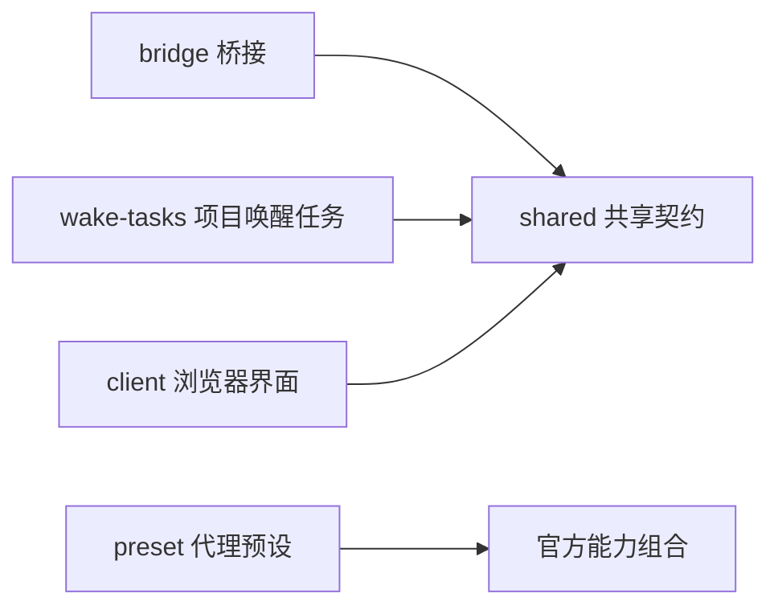

# 项目内 DSH 插件维护手册

本手册维护项目内 DeepSeek Harness（DSH，代理执行宿主）集成。唯一安装包为 `@voice-terminal/dsh-plugin`（语音终端功能包），项目插件版本为 `0.2.1`，桥接协议版本为 `2.0`。上游宿主锁定预发布版 `dsh-v0.2.1-rc.2`，提交号 `687f282e8625c6b8d11ff58211a90524be2e4317`；三种版本分别管理，不以插件版本推断宿主或协议版本。

源码唯一入口是 [`integrations/dsh/voice-terminal/`](../../integrations/dsh/voice-terminal/README.md)。运行源码、产物和数据分别位于项目 `.local/build/dsh/source`（官方源码）、`.local/build/dsh/bundles/voice-terminal`（统一插件产物）及 `.local/data/dsh`（项目数据目录）。本流程不安装或维护用户级 DSH，不变更语音端的后端选择，也不发布桌面程序。

## 组件职责与边界

`components.json`（组件声明）使用 `schema_version`（声明格式版本）、`id`（组件标识）、`description`（中文职责）、`entry`（源码入口）、`runtime_entry`（安装产物入口）、`loader_id`（宿主加载行标识）和 `depends_on`（组件依赖列表）。源码入口用于维护检查，运行入口用于发布闭包检查；安装产物不包含 TypeScript（静态类型语言）源码。

| 组件 | 源码入口，相对于插件目录 | 负责内容 | 生命周期所有者 |
| --- | --- | --- | --- |
| `bridge`（桥接） | `src/bridge/plugin.ts` | 会话绑定、上下文合并与门禁、8 个根代理工具（含按需截屏）、回执、观察、工作区及模型设置 | 桥接插件上下文及绑定的根代理 |
| `wake-tasks`（项目唤醒任务） | `src/wake-tasks/plugin.ts` | 8 个任务及语音事件工具、任务接口、持久化、旧项目任务迁移、定时投递 | 任务插件上下文及任务服务 |
| `client`（浏览器界面） | `src/client/index.ts` | 设置页、消息渲染、语言资源和界面插槽 | 浏览器插件上下文及服务期间注册 |
| `preset`（代理预设） | `preset/shadow-agent/agent.cordis.yml` | 官方工具、压缩、子代理及工作流的完整组合 | 官方代理预设注册器 |
| `shared`（共享契约） | `src/shared/protocol.ts` | 协议、稳定标识、鉴权、网络传输、取消作用域、设置契约、生成提示词 | 使用它的组件 |



桥接与任务组件没有互相导入。共有鉴权、回环地址约束和传输实现只维护一份；任务组件通过公开语音接口取得当前语音会话。浏览器只使用共享类型和设置契约，不导入宿主运行实现。组件依赖必须先声明，构建检查会拒绝未声明依赖、循环依赖和缺失入口。

一次安装只登记一个功能包。`host.patch.yml`（宿主组合补丁）保持两个独立加载行：根包入口加载桥接，`./wake-tasks`（任务子入口）加载任务组件。构建再合入 `preset-shadow-agent`（预设加载行）。只有根包声明 `dsh.client`（浏览器模块元数据），避免任务子入口重复注册设置页。

## 必须保持的兼容契约

| 契约 | 保留值及维护要求 |
| --- | --- |
| 加载行 | `voice-terminal-shadow-bridge`（桥接行）、`voice-terminal-wake-tasks`（任务行）、`preset-shadow-agent`（预设行）；包名变化不能改变行标识 |
| 设置命名空间 | `voice-terminal-shadow-bridge`（桥接设置）；保留已有工作区、模型、推理强度和恢复提示 |
| 消息来源 | `plugin:voice-terminal-shadow-bridge`（桥接消息来源）；语音端和客户端依赖此值 |
| 预设标识 | `shadow-agent`（影子代理预设）；保持原有官方默认工具、压缩、子代理及工作流能力 |
| 网络接口 | `/api/voice-terminal-shadow/v1`（桥接接口）、`/api/voice-terminal-wake/v1`（任务接口）、`/api/internal/dsh-bridge/`（语音回调前缀，含 `screen.capture`（DSH 按需截屏）） |
| 任务存储 | `storages/voice-terminal-wake-tasks.json`（项目任务文件）；`schema_version: 1`（存储格式版本）、`tasks`（任务记录）、`deleted_task_ids`（删除确认标识） |
| 会话映射 | `.local/build/dsh/session-mappings.json`（语音与 DSH 会话映射）；`schema_version: 2`（映射格式版本） |
| 桥接信封 | `protocol_version`（协议版本）、`request_id`（幂等请求标识）、`voice_session_id`（语音会话标识）、`dsh_session_id`（DSH 会话标识）、`epoch`（会话世代） |
| 激活与上下文 | `activation_id`（激活标识）、`context_revision`（上下文版本）；过期调用必须保持拒绝，不能用新激活替代旧请求水位 |
| 实时运行轨迹 | `shadow.activity`（内部活动回调）的 `action_seq`（动作序号）在激活内递增，思考、工具和运行状态串行发送；`activity`（实时活动正文）只使用绑定根代理的公开实时流及工具事件，字段与拒收规则见 [桥接活动协议](../architecture/bridge-2.0-protocol.md) |

8 个根代理工具为 `capture_screen`（捕获前台屏幕双图）、`get_latest_context`（读取权威上下文）、`publish_progress`（发布进度）、`publish_voice_information`（发布可替换信息）、`request_early_silence`（请求提前静默）、`request_user_input`（请求用户澄清）、`return_shadow_result`（提交终态结果）、`finish_shadow_no_action`（终态无需动作）。均只安装到已绑定的根代理，子代理不能通过伪造会话标识调用。`capture_screen`（按需截屏工具）使用当前绑定的 `voice_session_id`（语音会话标识）、`dsh_session_id`（DSH 会话标识）、`epoch`（会话世代）和 `activation_id`（激活标识），由服务端校验激活并复用屏幕捕获服务；插件校验图片长度、媒体类型和 `sha256`（内容摘要）后写入 DSH 附件库。截图只进入当前 DSH 工具结果，受“屏幕图像”设置控制，不新增 Voice 用户发言。捕获事实字段的中文说明见[屏幕双图输入](screen-input.md)。

8 个任务工具为 `schedule_wake`（简易创建）、`cancel_wake`（取消）、`read_wake_reference`（按需读取冻结参考）、`publish_voice_event`（发布语音事件）、`wake_task_create`（创建）、`wake_task_list`（查询）、`wake_task_update`（更新）、`wake_task_delete`（删除）。保留完整任务标识、历史、删除确认、写入失败恢复及重启恢复。

以下行为不得在结构整理中改变：

- 终结型桥接工具仅在回执 `accepted`（接受）或 `duplicate`（重复已接受）时调用 `exec.concludeTurn()`（结束当前回合）；拒绝、过期或失败回执继续按原规则处理。任务事件发布同样遵循确认后结算规则。
- 进度继续登记二等信箱，由语音端在 4 秒检查点或普通请求中评估；信息和终态通过普通事件路径处理。DSH 的普通助手文字不会自行转成播报。
- 长推理的 20 秒软提醒通过下一步安全边界注入，不唤醒空闲代理，不中断工具；终态或解绑后停止。
- 设置更改作用于下一次新建语音会话；恢复会话继续保留原会话选择。失效工作区或模型按原规则回退并展示提示。
- 项目任务只迁移旧语音任务，不读取官方会话调度存储。冻结参考由读取工具按需取得，不自动加入模型上下文。

## 依赖与官方规范

规范以锁定提交的官方源码为准，不照搬其他版本的例子。主要依据是 [官方开发约定](https://github.com/deepseek-ai/deepseek-harness/blob/687f282e8625c6b8d11ff58211a90524be2e4317/AGENTS.md)、[包维护约定](https://github.com/deepseek-ai/deepseek-harness/blob/687f282e8625c6b8d11ff58211a90524be2e4317/packages/AGENTS.md)、[插件发布文档](https://github.com/deepseek-ai/deepseek-harness/blob/687f282e8625c6b8d11ff58211a90524be2e4317/docs/user/develop/basic/publish.md)、[工具添加指南](https://github.com/deepseek-ai/deepseek-harness/blob/687f282e8625c6b8d11ff58211a90524be2e4317/docs/cookbook/adding-a-tool.md)、[防御模式](https://github.com/deepseek-ai/deepseek-harness/blob/687f282e8625c6b8d11ff58211a90524be2e4317/docs/defensive-patterns.md)、[浏览器维护约定](https://github.com/deepseek-ai/deepseek-harness/blob/687f282e8625c6b8d11ff58211a90524be2e4317/packages/client/AGENTS.md)和[界面插槽规范](https://github.com/deepseek-ai/deepseek-harness/blob/687f282e8625c6b8d11ff58211a90524be2e4317/docs/subsystems/slots.md)。

| 依赖类别 | 当前配置 | 维护原则 |
| --- | --- | --- |
| `dependencies`（普通运行依赖） | `@deepseek-ai/schemastery`（配置模式库）`~3.18.5` | 纯配置构建依赖；不要夹带第二套宿主服务 |
| `peerDependencies`（同宿主运行依赖） | Cordis（插件框架）`~4.0.5`，DSH 工具、调度、模型、会话和工作区包 `0.2.1-rc.2` | 使用宿主提供的包实例与公开导出；开发版本必须与同宿主版本一致 |
| `devDependencies`（开发依赖） | 上述同宿主包、公开服务类型、浏览器包、React（界面库）、TypeScript（静态类型语言） | 类型专用导入使用 `import type`（仅类型导入）；不能靠开发依赖掩盖实际运行导入 |
| `dsh.client.inject`（浏览器注入依赖） | 8 个官方会话、工作区、语言、基础控件、渲染、设置、会话消息及聊天包 | 只声明实际使用服务，不用跨界面包的值导入获取其他组件 |

项目复用公开 `@deepseek-ai/dsh-schedule`（调度规则库）的解析与时间计算，但不依赖官方 Automation（自动化功能包）处于启用状态。官方 `schedule_*`（会话调度工具）仍由官方可选功能包提供，与项目任务保持独立。安装迁移保留用户启用的官方功能包和其他自定义插件。

宿主插件遵守以下规则：

1. 导出命名的 `name`（插件名）、`inject`（服务依赖声明）、`Config`（配置模式）和 `apply`（装配函数）。必需服务声明在依赖中，可选服务通过 `ctx.get()`（上下文服务查询）取得。不要自行复制宿主对象。
2. 工具使用公开 `defineTool()`（工具定义函数），由模式推导参数与输出类型；使用公开标识构造函数，不把任意字符串强制转换成宿主会话、工作区或消息标识。
3. 锁定版本的工具模式语言不支持数值上下限、字符串长度和数组数量的额外关键字。范围放在中文描述并保留运行时边界校验；不要添加 `minimum`（数值下限）、`maxLength`（字符串长度上限）等不支持的模式字段。替换工具时保留已有边界语义。
4. 分开宿主与浏览器类型配置，保留严格类型检查、可选字段精确检查和索引越界检查。禁止 `any`（任意类型）和双重强制转换绕过服务契约。历史自由结构使用 `unknown`（待校验类型），先验证后使用。
5. 网络调用复用共享传输层，保留请求大小限制、身份校验、回环地址约束和超时。调用方 `AbortSignal`（取消信号）与组件取消信号共同生效。
6. 定时器、路由、事件监听、工具和代理都必须有生命周期所有者。解绑或卸载先停止新工作，取消并等待未完成回调。代理使用公开 `dispose()`（释放接口）；取消原因使用宿主规定的结构，不能以裸字符串冒充。
7. 不修改官方运行源码，不从宿主内部文件路径导入功能，不通过环境变量注入内部调度模块路径，也不解析私有会话文件代替公开接口。
8. 实时运行轨迹使用公开 `AssistantStreamFrame`（助手实时流帧）类型，按 `revision`（实时流修订号）与 `attemptId`（模型尝试标识）过滤旧流；思考刷新定时器、串行回调队列和网络请求均归属当前绑定，激活替换、解绑和卸载必须清理。该正文只供工作台固定单槽显示，不进入语音推理或长期历史。

浏览器组件使用 `inject.hooks`（可观测状态钩子注入），设置页从官方设置表单服务获得状态与变更入口，工作区使用官方状态钩子。页面、语言和渲染贡献随上下文释放；设置页通过 `whileServed()`（服务可用期间注册）跟随命名空间的存在。不自行使用 `useSyncExternalStore`（手动外部状态订阅）或额外状态镜像模拟官方钩子。

## 新功能与修改流程

1. 先确定所属组件以及用户可见行为。属于一个组件的功能留在该组件；确实跨组件共用的协议或无状态能力才进入共享目录。新增组件必须更新组件声明、依赖、运行入口和宿主组合补丁。
2. 明确输入、输出、拒绝条件、取消方式、幂等规则和数据所有者。每个新增英文专业名词及公开字段配中文说明；错误回执必须使调用者能区分拒绝、重试和已完成。
3. 检查包清单：实际运行导入必须属于普通或同宿主依赖，浏览器服务必须加入浏览器依赖声明，类型引用加入对应类型配置。不得为了消除类型错误放宽全局检查。
4. 工具、异步功能和界面变更需覆盖根代理身份、旧激活拒绝、边界参数、终态结算、取消清理及设置服务重复出现等边界；回归范围见[测试、启动与现场验收入口](../testing/operations-and-quality.md#dsh-插件专项回归)。
5. 数据格式变更先设计版本判断、幂等迁移、失败回滚和旧记录保留。不能删除旧字段后再试图推断迁移。项目任务、原生会话任务和语音映射不得混用。
6. 更新本手册与相应协议、操作文档，按[专项回归入口](../testing/operations-and-quality.md#dsh-插件专项回归)完成验证后再安装。调整上游版本时同时检查版本锁、许可证、公开接口、包依赖和真实组合测试，不追踪浮动版本。

## 构建与项目安装

以下构建命令在仓库根目录运行；使用已有锁定宿主源码及其依赖：

```powershell
node integrations/dsh/voice-terminal/build.mjs
```

插件自动化回归与隔离安装烟测见[测试、启动与现场验收入口](../testing/operations-and-quality.md#dsh-插件专项回归)。

涉及协议、上下文、生命周期或公共事件时，回归命令、覆盖范围和现场验收边界见[测试、启动与现场验收入口](../testing/operations-and-quality.md)。自动化通过不等同于真实模型、麦克风和播放设备的现场验收。

安装前按项目流程停止 Voice Server（语音服务）。安装脚本检查实际监听端口；服务仍在运行时会拒绝部署，不能改端口变量绕过正在使用的项目实例。

```powershell
pwsh -NoProfile -File scripts/setup-dsh.ps1 -Offline -SkipInstall
pwsh -NoProfile -File scripts/setup-dsh.ps1 -Offline -ValidateOnly
node scripts/dsh-diagnose/compare-build-state-hashes.mjs
node scripts/dsh-diagnose/upgrade-smoke.mjs
```

`-Offline`（离线模式）使用已存在的固定宿主和依赖缓存；`-SkipInstall`（跳过宿主依赖安装）仍构建并安装项目插件；`-ValidateOnly`（仅校验）不部署。缺少宿主依赖或需要升级宿主时使用完整安装流程，见[项目 DSH 基线](../../config/dsh/README.md)。完成校验后按项目流程启动语音服务，并从受管入口打开控制台。

安装复用生产宿主，仅同步受管插件，保留用户补丁和官方任务选择。程序与环境升级通过覆盖发布事务换入，短期旧组件在验证成功后删除；重要数据只保留一份滚动备份。

## 一体化助手提示词

语音交互链路与 DSH（后台执行宿主）共同呈现同一 Voice Terminal（语音终端）助手。主语音模型的身份和动作路由写在
`voice_terminal/agent/prompts.py`（语音系统提示词）；共享后台规则写在
`config/shadow_agent/instructions.md`（公共后台提示词），DSH 专属规则写在
`config/dsh/shadow-agent.rules.md`（后台任务提示词）。
`preset/shadow-agent/agent.cordis.yml`（后台代理预设）中的身份说明须保持一致；不得恢复“独立影子助手”或要求用户改向另一端下达任务。

语音端与公共后台提示词均需按完整表达、对话上下文和仍有效的任务目标理解 ASR（自动语音识别）转写，容许同音或近音替换、漏字、断句及标点误差；同一轮的 `asr_final`（识别最终稿）和 `refinement`（精修稿）是同次发言的不同证据，精修稿不天然优先。只在上下文依据充分且不改变关键条件时按候选含义理解；对否定、数量、金额、时间、专有名称、操作对象及执行条件，不凭语感自行修正。歧义会实质改变答案或操作且上下文无法消除时，只确认歧义部分；实际操作由后台核对，并在关键条件确认前暂停相关操作。

实际操作、外部查询和所有定时请求由语音动作 `request_shadow`（请求后台执行）进入后台，
只发送固定参数 `request`（请求标记）。语音会话创建、查询、修改和取消提醒时使用项目
`wake_task_*`（语音链路任务工具），仅当用户明确要求提醒只留在 DSH 会话时使用官方
`schedule_*`（后台会话任务工具）。使用现有回执确认任务状态；任务到期需要提醒用户时，
由 `publish_voice_event`（投递语音事件）发送回语音链路。不得重复创建任务或用等待、口头答应代替任务操作。

公共提示词与 DSH 专属规则由构建脚本按这个顺序生成唯一受管桥接指令：
`config/shadow_agent/instructions.md`（公共规则）后接 `config/dsh/shadow-agent.rules.md`（DSH 规则）。
这条桥接指令与根代理系统提示（system prompt，系统提示）是不同路径；根代理的人设由
`integrations/dsh/voice-terminal/preset/shadow-agent/agent.cordis.yml`（影子代理预设配置文件）维护。
当前 `persona`（人设）启用了 `complete: true`（完整人设模式），只有渲染后的 `prefix`（系统提示前缀）
作为该人设的系统提示；`suffix`（系统提示后缀）和其他提示词区块不会合并进去。项目 DSH 使用
`.local/data/dsh`（项目 DSH 数据目录）作为 `DSH_HOME`（DSH 数据目录）；用户目录中的
`AGENTS.md`（代理指令文件）不能代替这个预设的人设系统提示，稳定控制该预设语言时应直接维护 `persona.prefix`。

要让后台推理（reasoning，推理）及思考流（thinking stream，思考输出）使用简体中文，应将规则写入该预设的
`persona.prefix`（人设系统提示前缀），要求直接用中文生成，不要先用英文展开再翻译，并保留代码、命令、路径、
配置项、标识符和错误原文。`shadow_prompt_sha256`（后台桥接指令摘要）覆盖受管桥接指令；预设修改由预设源码
新鲜度及运行产物摘要核验。修改受管规则或预设后都必须重建插件、运行 DSH（后台执行宿主）验证并安装，
再按项目维护流程重启 Voice Server（语音服务）和 DSH（后台执行宿主）。通过这些步骤后新会话使用新配置；
已经开始的语音会话继续使用它原有的冻结提示词。

`build-state.json`（构建记录）格式更新为 `schema_version: 6`（格式版本），记录 `plugin_bundle_version`（统一插件版本）、`plugin_runtime_artifacts_sha256`（运行产物摘要）、`plugin_build_inputs_sha256`（构建输入摘要）、`shadow_prompt_sha256`（提示词摘要）及宿主身份。源码新鲜度检查覆盖全部组件源码、预设、清单、声明、构建和检查脚本、宿主补丁及两套类型配置；运行摘要覆盖包清单、生成补丁、组件声明和完整编译目录，包括源码映射。文档与测试不参与运行新鲜度判断。

公共桥接指令仍由 `config/shadow_agent/instructions.md`（公共指令）与 `config/dsh/shadow-agent.rules.md`（DSH 专属规则）按原顺序生成，不要复制出第二份受管桥接指令。`persona.prefix`（人设系统提示前缀）是项目预设的系统提示配置，按预设源码及运行产物摘要跟踪。新增运行文件必须进入编译目录或显式加入构建输入和运行摘要；PowerShell（安装脚本）、Python（运行校验）及 Node.js（诊断脚本）三处摘要算法必须一致。

## 维护完成标准

- 一个安装包、三个稳定加载行、一个浏览器模块；没有旧包重复登记或遗漏运行入口。
- 旧工具名、拒绝规则、回执语义、任务恢复、设置保存和完整预设能力的回归范围见[DSH 插件专项回归](../testing/operations-and-quality.md#dsh-插件专项回归)。
- 类型与依赖检查通过；共享逻辑无重复；组件卸载后不遗留网络回调、计时器、路由或代理。
- 安装、重复安装及失败恢复可验证；用户插件、原生自动化、任务、会话映射和设置得到保留。
- 新功能的中文字段说明、行为回归及维护说明齐全；真实模型和设备验收与隔离测试的边界明确。

排障先检查构建状态、完整摘要和展开配置，再检查公开接口回执与加载器状态。日志只记录必要标识和错误；不得输出访问令牌、模型密钥、鉴权头或带令牌的控制台地址。当前维护以本手册和统一源码目录为准。
