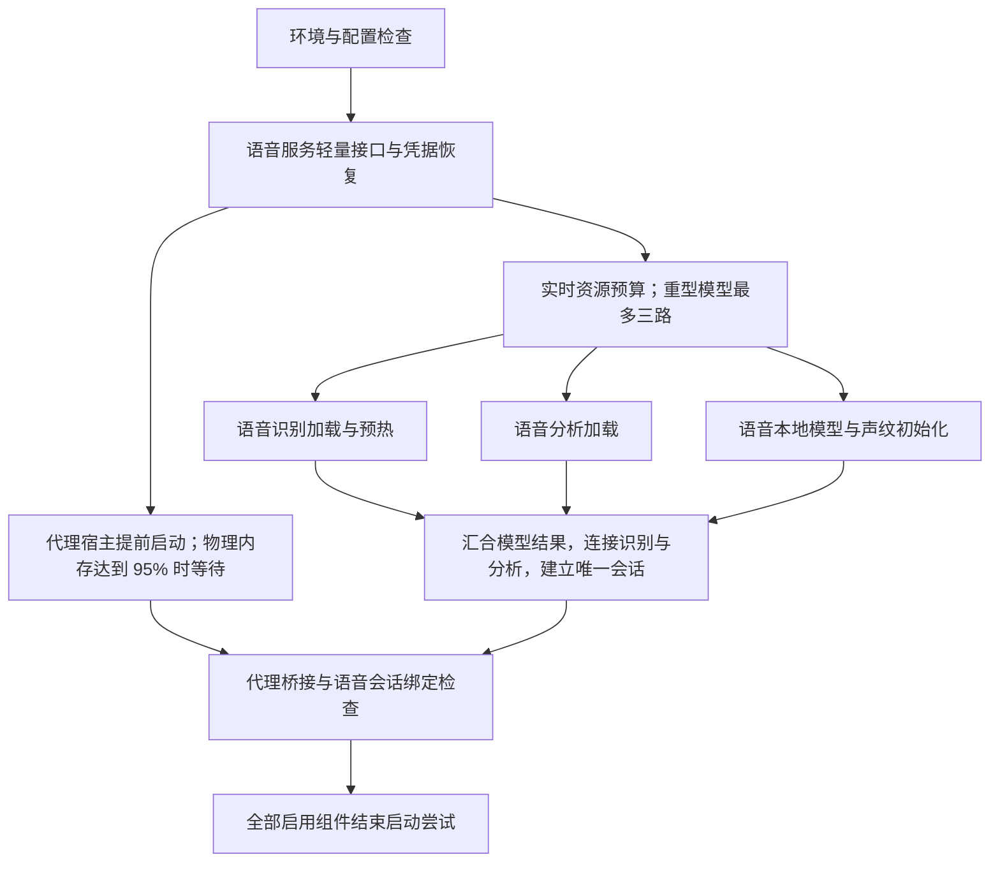

# ASR（语音识别）启动与并行调度梳理

日期：2026 年 10 月 7 日。识别按需导入、轻量业务接口提前开放、DSH（代理执行宿主）提前并行启动和最多三路重型模型加载均已实现，并更新本机正式程序。下面先给出当前规则，再保留优化前的串行路径与导入诊断依据。阶段验收见[识别优化实施与验收](startup-optimization-acceptance.md)和[第二轮启动并行优化验收](startup-parallel-acceptance.md)。

## 当前已实现的启动关系

环境与有效配置检查完成后，应用宿主先创建 Voice Server（语音服务）的轻量入口，恢复凭据并开放设置、状态与受管接口；原语音进程管理器同时启动 DSH（代理执行宿主）。随后按实时资源预算放行 ASR（语音识别）、分析工作进程、语音本地模型三路加载。语音本地模型一路内仍按原依赖顺序初始化音频、KWS（关键词唤醒）、VAD（语音活动检测）和按配置启用的声纹。



DSH（代理执行宿主）不占三路重型模型加载通道。物理内存使用率低于 95% 时立即启动；达到 95% 时每秒重采样，回落后继续；采样不可用时允许启动。它不按模型的处理器、提交内存或显存预算排队，内存等待不消耗实际启动超时。模型采样可用的物理内存已经包含代理占用，无须将代理额外算成一条模型加载通道。

`voice_api_ready`（轻量业务接口已监听）只开放设置和查询。`startup_complete`（全部启用组件结束启动尝试）与 `core_available`（核心语音能力可用）继续控制语音操作；组件失败仍按既有规则进入降级或故障状态。点击“跳过”进入本地组件页，背景加载继续，界面选择不改变这些状态。

## 优化前的串行路径

优化前，`voice_terminal/application/supervisor.py`（应用进程监督器）的 `startup`（启动调度）依次等待：

```text
环境与配置检查
  → ASR（语音识别）加载、预热、接口健康检查
  → 分析进程：SmartTurn（语音结束判断）、SenseVoice（整句语音精修）
  → Voice Server（语音服务）完整初始化及接口健康检查
  → DSH（代理执行宿主）启动、桥接就绪与绑定
  → startup_complete（完整启动标识）
```

优化前，Voice Server（语音服务）内部还依次初始化音频、KWS（关键词唤醒）、VAD（语音活动检测），连接识别进程，等待声纹工作进程，建立模型客户端和唯一会话调度器。声纹已位于语音服务初始化内部；监督器的委托组件检查不再另行启动它。

优化前的接口在 Uvicorn（服务运行库）的 `lifespan`（应用生命周期）完成 `runtime.initialize`（语音运行时初始化）后开放。受管模式不会自动启动 DSH（代理执行宿主），必须等监督器发送 `dsh-start`（启动代理宿主命令）。第二轮将受管模式分为轻量入口、本地模型和会话汇合三个阶段，消除了代理进程等待识别模型加载的关系；独立后端仍沿用完整初始化入口。

此前同一实际启动样本约 196.5 秒：识别进程创建至接口监听约 51.8 秒；分析进程创建至两通道就绪约 33.2 秒；语音进程创建至代理宿主进程创建约 37.2 秒；代理宿主进程创建至桥接就绪约 63.9 秒。这些是已有实例的历史阶段观测，统计边界不同，不能直接相加当成完整启动耗时，也不能与后续隔离进程诊断直接计算提速比例。

## 真实依赖与可并行部分

| 组件 | 必要依赖 | 可调整的调度关系 |
| --- | --- | --- |
| ASR（语音识别） | 配置、运行环境、本地模型与设备资源 | 与分析进程互不依赖，可按资源预算并行 |
| 分析进程 | 配置、运行环境、本地模型与设备资源 | 不必等待识别进程；内部两模型仍须分别评估加载资源 |
| 语音服务的轻量入口 | 配置、身份恢复、凭据恢复及状态接口 | 可在模型进程就绪前开放设置和受管状态接口 |
| 语音服务的完整能力 | 音频、唤醒与检测模型、识别连接、声纹及会话调度器 | 识别连接和分析绑定必须等对应进程的受管健康状态确认 |
| DSH（代理执行宿主）进程 | 有效配置、凭据及原有生命周期管理 | 可由提前启动的语音服务在后台启动；不依赖识别模型加载 |
| 代理会话绑定 | 代理桥接就绪及语音会话身份、调度器就绪 | 可以在两条分支都完成后执行 |

监督器创建语音进程时把 `VOICE_APP_ASR_AVAILABLE`（识别进程已确认可用）和 `VOICE_APP_ANALYSIS_AVAILABLE`（分析进程已确认可用）写入环境变量。相应客户端在值为零时拒绝连接，并不会因其他进程稍后就绪自动恢复。第二轮通过 `initialize-session`（受管会话初始化命令）先验证并更新两个依赖状态，再连接识别、分析并建立唯一会话；代理桥接等待该阶段结束后绑定。

## ASR（语音识别）的主要耗时证据

当前正式环境是 FunASR（语音框架）1.4.14。两次独立新进程沿用正式程序的 Python（后端运行时）和缓存读取路径，仅导入模块并执行硬件检查，不加载模型权重、不启动服务、不读取凭据或改变用户配置。启用 `-X importtime`（逐模块导入耗时记录），未清理系统文件缓存。

| 阶段 | 第一次诊断 | 第二次诊断 |
| --- | ---: | ---: |
| 资源策略初始化 | 0.06 秒 | 0.04 秒 |
| 工作进程入口模块 | 0.90 秒 | 0.33 秒 |
| NumPy（数值计算库） | 0.88 秒 | 0.10 秒 |
| FunASR（语音框架）与 AutoModel（模型加载入口） | 29.16 秒 | 9.49 秒 |
| 完整后端硬件探测及显卡设备选择 | 2.00 秒 | 1.32 秒 |
| 上述阶段合计 | 33.00 秒 | 11.28 秒 |

两次都导入了 399 个 FunASR（语音框架）模块。差异表明文件缓存和运行环境影响明显；第二次仍是新进程，不代表首次系统冷启动。导入计时本身有额外记录开销，结果只用于定位，不能作为完整服务启动基准。

包入口会递归导入全包。逐模块记录显示 AutoModel（模型加载入口）本身还在模块级导入聚类组件，带入 scikit-learn（机器学习库）；全包导入同时带入 Transformers（文本模型库）等依赖。第一次记录中 Transformers（文本模型库）的累计导入约 5.64 秒，scikit-learn（机器学习库）约 9.28 秒；这些累计时间包含嵌套模块，不能继续与子模块累计耗时相加。

仅导入和硬件检查后，识别诊断进程的常驻内存已约 1.05 GiB（以 1024 为基数的容量单位），私有提交约 2.75 GiB。尚未读取约 840 MiB（以 1024 为基数的容量单位）的模型权重，也没有模型构造或预热。这也说明同时创建多个模型进程需要考虑初始化峰值，不能只看待机常驻内存。

已有日志中本次识别预热为约 1.21 秒。完整流式窗与空最终刷新会验证真实算子、显卡计算和设备回退，应保留。日志中的“download models from model hub”（从模型仓库解析模型）也不能作为发生网络下载的证据；现有加载器在本地目录存在时读取该目录的配置和权重。

本轮诊断所用 FunASR（语音框架）1.4.14 的包入口执行递归导入。仅改为导入 `funasr.auto.auto_model`（模型加载子模块）仍会初始化父包，因此按需适配同时处理包扫描与可选聚类导入；适配的固定版本、摘要校验、真实模型一致性和完整导入回退见[识别优化验收](startup-optimization-acceptance.md)。

## 分轮实施结果与后续范围

实现按下面的顺序分轮交付。前三项已完成；第四项已统一线程预算，重复硬件探测复用仍待后续评估。

1. **减少识别进程的依赖导入，已完成。** 对固定版本及入口摘要启用内存加载适配，只注册 ParaformerStreaming（流式识别模型）、SANM（识别编码与解码结构）、CIF（连续积分发放预测器）、在线音频前端、频谱增强和字符分词器等真实依赖。可选说话人聚类延至使用分支，其他模型家族不提前扫描。保留现有模型、推理窗口、累计转写、最终刷新、真实预热与设备回退规则；未知版本、配置或适配失败恢复完整导入，不改写正式运行库。

2. **按预算并行识别和分析进程，已完成。** 首轮先实现两路候选与识别优先的保守放行，完成真实权重及受管进程验收。第二轮将语音本地模型纳入同一调度器，并按最新要求将上限调整为三路。

3. **提前创建语音服务的轻量入口，使代理宿主与模型加载重叠，已完成。** 恢复凭据并开放状态与设置接口，从原语音服务所有者启动 DSH（代理执行宿主）后台任务。语音本地模型按同一资源预算加载，随后汇合识别与分析结果并建立会话。代理只保留 95% 物理内存门槛，继续使用原来的端口校验、启动、健康检查、退出和重试流程；本轮没有单独优化其内部加载。

4. **统一线程预算，硬件探测复用留待后续。** 已通过 `VOICE_MODEL_THREADS`（模型线程预算）将识别进程的原生线程预算传给 AutoModel（模型加载入口）的 `ncpu`（张量计算线程数）。识别进程仍探测 ONNX Runtime（模型推理运行时），分析进程也自行探测；静态能力复用尚未实施，后续必须保留实际模型加载、预热与实时资源采样验证。

## 动态并行的当前预算与验收边界

本机是 14 核、20 个逻辑处理器、约 15.7 GiB（以 1024 为基数的容量单位）物理内存。此次采样在正式应用未运行时，可用物理内存也仅约 2.4 GiB。因此不能按处理器数量直接开启多路模型加载。应结合可用物理内存、剩余提交内存、可用显存、当前计算负载、待启动模型的实测加载峰值与线程预算决定是否放行。

模型调度最多同时加载三路，不保证每台机器都开启三路。追加分支前检查可用物理内存、剩余系统提交内存、处理器占用与线程预算；多路可能使用显卡时累加预留显存。保守预算如下，属于加载放行估计，并非实际占用测量：

| 模型分支 | 常驻内存预算 | 私有提交预算 | 显存预算 |
| --- | ---: | ---: | ---: |
| 语音识别 | 3 GiB | 7 GiB | 2 GiB |
| 语音分析 | 4 GiB | 10 GiB | 3 GiB |
| 语音本地模型与声纹 | 3 GiB | 7 GiB | 2 GiB |

GiB（以 1024 为基数的容量单位）。额外保留 1 GiB 物理内存、2 GiB 提交内存和 0.5 GiB 显存；已经分配的物理与私有提交从加载余量中扣除，加载中的显存预算保持完整预留。处理器使用率达到 80%、线程预算不足或必要采样不可用时不追加并行分支；没有其他加载任务时仍放行单路，避免无限等待。声纹启用时，其线程预算计入语音本地模型分支。

排队组件显示“等待资源”。识别和分析进程真正创建后才开始 `worker_timeout_seconds`（工作进程启动超时预算）计时；语音轻量入口与受管模型初始化分别限时。`VOICE_STARTUP_PARALLEL=0`（重型模型采用串行）只用于模型加载对照，不关闭代理提前并行。

关键词唤醒与语音检测的原生构造已放入受控后台线程，使设置、状态查询与代理后台任务可以持续处理。构造取消时等待原生加载结束并回收结果；退出期间不再创建排队组件或新的声纹进程。

完整启动仍等待全部启用分支完成检查。失败分支应报告错误或降级，其他独立分支继续完成；退出时取消未放行任务并回收已创建的受管进程。设置页面先可访问，语音会话和录音操作继续受完整启动标识约束。

已完成识别真实权重对照、资源充分时三路加载与第四路拒绝的自动检查、低资源真实进程启动及加载期间退出。真实完整进程样本中的代理约 6.55 秒创建，全部模型与桥接绑定约 67.38 秒结束；当时重型模型实际串行，代理仍提前并行。测试使用隔离数据和占位凭据，未开始语音会话或在线模型推理，也不代表原生桌面窗口基准。新增的系统冷启动、资源充分时真实三路加载、持续会话和不同机器样本仍需独立测量，不能据现有样本推断通用提速比例。

原始记录位于 `.runtime/startup-analysis`（本机启动诊断目录），包括两份首轮阶段报告、逐模块导入记录及后续真实模型对照，不随源码提交。后续实施与正式程序状态以验收记录为准。
